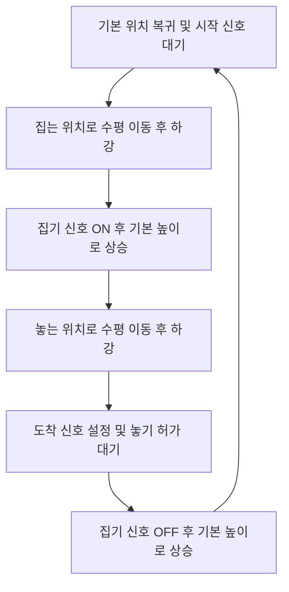

# LineWatch

realvirtual Starter 기반 로봇 피킹·분류 라인 관제 시뮬레이터 포트폴리오입니다.

## 현재 진행 상태

Unity 환경 구성과 Starter Getting Started 데모 실행 검증, LW-01 RobotLab 작업 씬·SCARA 작업 프리팹 구성을 완료했습니다. 씬 재열기·참조 검사와 기본 Play 검증에 이어 LW-02 Windows x64/Mono 빌드의 독립 실행·화면·정상 종료 및 Player 로그 검증도 마쳤습니다. 자체 C# Drive·Sensor 연결, 4축 SCARA FK·IK, 분류 제어, 관제 UI, 고장 대응과 외부 서버 연동은 개발 예정 범위입니다.

자세한 범위와 검증 기준은 [기획안](Assets/Docs/Starter_Portfolio_Plan.md)에 있습니다.
실제 작업 순서와 완료 기준은 [작업 체크리스트](Assets/Docs/LineWatch_Work_Plan.md)를 따릅니다.

## 개발 환경

- Unity 6000.3.21f1 / URP
- realvirtual Starter 6.3.6 (별도 설치)
- Windows PC 우선

## 프로젝트 열기

1. 이 저장소를 클론하고 Unity Hub에 프로젝트 폴더를 추가합니다.
2. [realvirtual Digital Twin Starter 6.3](https://assetstore.unity.com/packages/tools/utilities/realvirtual-digital-twin-starter-6-3-366612)을 본인 Unity 계정의 My Assets에 추가합니다.
3. Unity Package Manager의 My Assets에서 Starter를 다운로드·가져오기 합니다. 검증한 버전은 6.3.6입니다.
4. Active Input Handling을 Both로 설정하고 Unity를 재시작합니다. URP와 TextMesh Pro 필수 리소스를 확인합니다.
5. Package Manager에서 Starter의 Getting Started 샘플을 가져오고 DemoRealvirtual 씬을 열어 Play로 확인합니다.

세부 설치 절차는 [제작사 가이드](https://realvirtual.io/doc/unity/basics/installation/)를 참고합니다. Starter 원본과 샘플은 공개 저장소에 포함하지 않아 각 개발 환경에서 직접 설치해야 합니다.

## 에셋 활용과 본인 구현 범위

구동부·센서·이송 등의 기반 기능과 제공 모델은 realvirtual Starter를 활용합니다. 본인 구현 예정 범위는 FK·IK 계산, 관절 제한과 해 선택, 로봇 피킹 제어, 관제 UI, 알람·복구, 외부 서버 연동과 성능 검증입니다. 제공 데모의 기능을 자체 구현 성과로 표시하지 않습니다.

New Gen Urban은 이 포트폴리오에 사용하지 않습니다.

## Starter SCARA 피킹 로직 분석

realvirtual Starter 6.3.6의 제공 스크립트 `LogicMove3AxisPickAndPlace`를 분석해 Drive 제어, 도착 판정, 집기 신호와 동작 순서의 연결 방식을 확인했습니다. 아래 내용은 **제공 코드의 분석 결과**이며, 해당 로직을 직접 구현한 성과로 표시하지 않습니다. 분석 대상의 로컬 설치 경로는 `Packages/io.realvirtual.starter/Runtime/PLCLogics/LogicMove3AxisPickAndPlace.cs`입니다.

### 역할과 제어 방식

이 스크립트는 세 개의 Drive에 미리 설정한 관절 목표값을 보내고, 도착 여부에 따라 다음 동작으로 넘어가는 상태 머신입니다. `Start()`에서 세 축을 기본 위치로 이동시키고, `FixedUpdate()`에서 문자열 `status`와 각 축의 `IsAtTarget`을 확인해 순서를 진행합니다.

`DriveTo()`는 목표값을 설정하고 이동을 시작하는 호출입니다. 이동 완료까지 호출을 대기시키지 않으며, 실제 이동은 Starter의 Drive가 담당합니다. 두 회전축에 명령을 함께 보내고 두 축 모두 도착했는지 확인하지만, 이 스크립트에서 두 축의 도착 시간을 일치시키는 계산은 수행하지 않습니다.

### 관절 목표값과 좌표의 구분

`StandardPos`, `Position1`, `Position2`는 `Vector3` 타입이지만, 현재 SCARA 프리팹에서는 **월드 XYZ 좌표가 아닌 세 Drive의 목표값 묶음**입니다. `.x`는 Axis1, `.y`는 Axis2, `.z`는 Axis3에 전달됩니다. Axis1·2는 로컬 Y축 회전으로 단위는 도(°), Axis3는 로컬 Y축 직선 이동으로 단위는 mm이며 이동 부호는 Drive 설정을 따릅니다.

| 원본 프리팹 설정 | Axis1 (°) | Axis2 (°) | Axis3 (mm) |
|---|---:|---:|---:|
| `StandardPos` — 기본 위치 | 90 | 0 | 0 |
| `Position1` — 집는 위치 | 0 | 0 | 100 |
| `Position2` — 놓는 위치 | 90 | 90 | 100 |

예를 들어 `Position2 = (90, 90, 100)`은 두 회전축에 각각 90°, 수직축에 100mm를 명령한다는 의미입니다. 관절값으로 TCP 자세를 계산하는 FK나 목표 TCP 자세에서 관절값을 구하는 IK는 이 스크립트에 포함되어 있지 않습니다.

### 동작 순서와 신호

| 신호 | 제공 코드에서의 동작 |
|---|---|
| `StartPickAndPlace` | 기본 위치에서 대기 중일 때 true이면 집는 위치로 이동을 시작합니다. |
| `Pick` | 집는 높이에 도착하면 true, 놓기 허가를 받으면 false로 설정합니다. 현재 프리팹의 Grip은 OneBitControl 방식으로 이 신호를 읽어 집기·놓기를 수행합니다. |
| `PlacePositionReached` | 놓는 높이에 도착하면 true, 놓은 뒤 상승을 완료하고 수평 복귀를 시작할 때 false로 설정합니다. 연결하지 않아도 되는 신호입니다. |
| `ContinueAfterPlace` | 연결되어 있으면 true가 될 때까지 놓기를 보류합니다. 연결되어 있지 않으면 바로 놓고 상승합니다. |

이 로직은 신호 컴포넌트의 `.Value`를 읽고 쓰며, 자체적인 외부 PLC 통신 코드는 포함하지 않습니다. 또한 센서를 직접 읽어 집기 성공을 판정하지 않고 Grip에 집기·놓기 신호를 전달합니다.

### 분석에서 확인한 한계

- **시작 조건:** `Start()`의 기본 위치 이동은 시작 신호와 관계없이 실행됩니다. 대기 상태의 시작 조건도 상승 에지가 아닌 현재 true 여부입니다. `startbefore`는 저장만 하고 비교에 사용하지 않아, 시작 신호가 계속 true이면 복귀 후 다음 사이클이 다시 시작됩니다.
- **성공 판정:** `Pick`을 true로 설정한 직후 상승을 명령하며, 실제 물체를 잡았는지 확인하는 단계는 없습니다. 놓기 성공과 상품 처리 완료도 별도로 검증하지 않습니다.
- **실패 대응:** 이동 시간 초과, 명령 수준의 도달 가능성 검사, 고장 복구·일시정지 상태를 이 스크립트에서 관리하지 않습니다. 도착 조건이나 놓기 허가가 충족되지 않으면 해당 상태에 머뭅니다.
- **참조 검사:** `StartPickAndPlace`를 일부 구간에서는 null 검사하지만, `FixedUpdate()` 마지막에는 `.Value`를 무조건 읽습니다. Drive와 Pick도 필수 연결을 전제로 하므로 참조가 빠지면 예외가 발생할 수 있습니다.

### LineWatch에 적용한 경계와 후속 구현

현재 RobotLab의 `ScaraRobot_Work`는 원본 SCARA 기반 Prefab Variant이며, 제공 피킹 로직은 비활성화했습니다. Drive 3개·Grip·Sensor와 내부 연결은 유지하고, 앞으로 자체 제어 코드와 제공 로직이 같은 Drive에 동시에 명령하지 않도록 구성했습니다. 패키지 원본은 수정하지 않았습니다.

본인 구현 예정 범위는 자체 C# Drive·Sensor 연결 검증, 4축 SCARA 구성과 FK·IK, 관절 제한 및 이동 제어, 집기·놓기 성공 확인과 운전 상태·고장 대응입니다. 이 분석은 Starter의 구동 기능과 본인이 작성할 제어 로직 사이의 연결 지점을 파악한 작업이며, 해당 기능의 구현·검증 완료 여부는 작업 체크리스트에서 구분합니다.

## 저장소에서 제외하는 항목

- Unity 캐시·로그·빌드 결과와 자동 생성 IDE 솔루션
- 유료 에셋 보관 폴더 Assets/10.Assets 및 해당 폴더 메타데이터
- realvirtual Starter 원본 패키지와 가져온 Starter 샘플

로컬에 설치한 에셋은 삭제하지 않습니다. 제3자 에셋의 이용 조건은 각 제작사 라이선스를 따릅니다.
