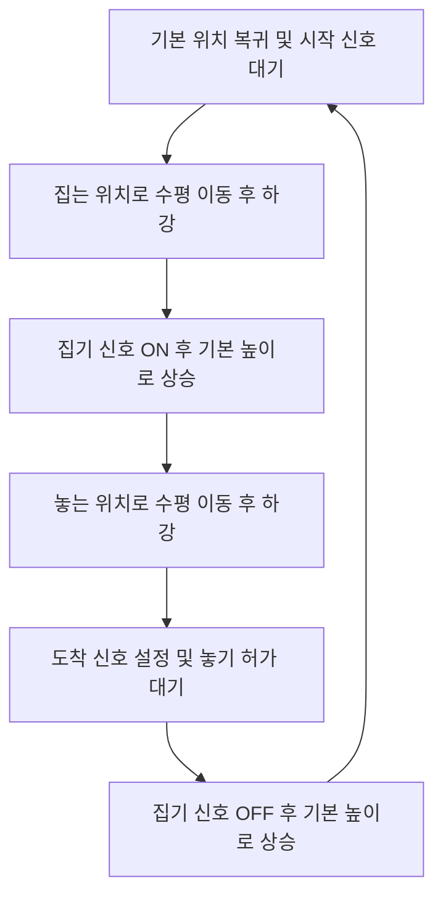

# LineWatch

제공 모델과 자체 C# 제어로 만드는 로봇 피킹·분류 라인 관제 시뮬레이터 포트폴리오입니다.

## 현재 진행 상태

**LW-07D 완료: FANUC 목표 입력·IK·실제 관절 이동·정지와 100개 실제 TCP 도착 검증을 마쳤습니다.** 고정 목표 100/100이 2mm·0.5° 기준을 만족했고 최대 오차는 약 0.09965mm·0.01910°입니다. 99개는 실제 이동했고 1개는 이미 허용 오차 안에 있어 추가 이동 없이 완료했습니다. 잘못된 요청의 명령 보존·중단/복구와 SCARA 100개 도착·경로 회귀도 통과했습니다. 다음은 LW-08의 양쪽 로봇 고정 경유점·집기 기반을 나눠 진행합니다.

기존 Windows x64/Mono 빌드 `Builds/Windows-OwnCode/LineWatch.exe`는 빌드 오류 0건이며 새 exe의 실행·종료 확인은 실행 권한 요청 거절로 미완료입니다. 초기 LW-02 실행 검증 이력과 구분하며, 기존 실행물에는 LW-04·FANUC의 후속 변경이 포함되지 않습니다.

자세한 범위와 검증 기준은 [기획안](Assets/Docs/Starter_Portfolio_Plan.md)에 있습니다.
실제 작업 순서와 완료 기준은 [작업 체크리스트](Assets/Docs/LineWatch_Work_Plan.md)를 따릅니다.

RobotLab에는 기존 SCARA와 **FANUC CRX-10iA/L**을 함께 배치했습니다. `FanucRobot_Work`는 제공 동작 코드를 제거하고 A1~A6를 자체 `RotaryAxis`와 `FanucJointLab`에 연결했습니다. FANUC 6축 수동 조작·홈 기하·FK/진단·순수 IK/전체 검증과 목표 미리보기·실제 관절 이동·100개 도착을 검증했습니다. 기존 조작 패널·FK·IK 미리보기 사용자 직접 확인을 마쳤고, 새 이동/정지 안내 뒤 2026-11-15 사용자가 다음 과정 진행을 승인했습니다. 개별 클릭별 수치는 별도 보고되지 않았습니다. 충돌 회피·두 로봇 통합과 기존 Windows 실행물 반영은 남아 있습니다.

2026-11-14 요청으로 **FANUC 자체 6축 FK·IK와 두 로봇 통합도 첫 완성판의 필수 범위**에 추가했습니다. 기본 역할은 SCARA가 투입 상품을 인계대에 놓고 퇴피한 뒤, FANUC가 받아 A/B 출구로 분류하는 것입니다. 인계대는 한 상품·한 로봇의 진입만 허용하며, 최종 완료 상품마다 두 로봇을 거친 처리 이력을 확인합니다. 기하 기준·전체 FK/IK·실제 목표 이동/도착 검증까지 마쳤고 경유점·집기·통합 동작은 남아 있습니다.

| 추가 과정 | 내용 |
|---|---|
| LW-07A 완료 | FANUC 6축 피벗·홈·회전축·RobotFrame·TCP·시뮬레이션 제한 저장·대조 |
| LW-07B 완료 | 순수 FK·진단 UI 사용자 확인·100개 자세×3배치×4도구의 1,200건 및 실제 이동 진단 대조 |
| LW-07C 완료 | 기준 조사·순수 IK·100개 목표/초기값 및 1,200개 배치/도구 수렴 검증 |
| LW-07D 완료 | 미리보기·최신 상태 재계산·동기 관절 이동/정지·100개 실제 도착·SCARA 회귀 |
| LW-12A | SCARA→인계대→FANUC 순차 전달·A/B 100개 상품의 보유자/집계 검증 |

진행 순서는 **SCARA LW-07 → FANUC LW-07A~07D → 양쪽 경유점·물류 셀·단독 집기 LW-08~12 → 순차 통합 LW-12A**입니다. 관제·알람·서버·최종 영상에도 두 기종의 ID·관절·TCP·실패 원인과 인계 상태를 연결합니다. FANUC는 전체 회전, SCARA는 수평각 오차를 확인합니다. 확대 범위의 일정은 FANUC 기구학·수렴 검증 후 재산정하며 기존 6~8주 추정과 구분합니다.

## 새 대화에서 이어가기

상세한 현재 상태·중요 파일·미해결 사항·미커밋 변경은 [워크플랜의 새 대화 인수인계](Assets/Docs/LineWatch_Work_Plan.md#새-대화-인수인계)에, 단계별 사용자 작업·AI 작업·검증 근거는 [기여와 검증 누적 이력](Assets/Docs/LineWatch_Work_Plan.md#기여와-검증-누적-이력)에 기록합니다. 새 대화에서는 이 두 절과 아래 AI 역할 분담을 먼저 읽고, 요청받은 LW 범위에서 이어갑니다.

최종 포트폴리오 정리에는 이 누적 이력과 단계별 완료 기록을 사용합니다. AI가 작성·실행한 부분과 사용자가 직접 확인한 부분을 구분하며, 이후 사용자의 수동 재현·코드 리뷰가 확인되면 날짜와 근거를 추가합니다. 중요한 기록과 측정값은 Markdown에 남기고, Git에서 제외된 로컬 로그가 없는 환경에서는 이전 검증 기록과 새 검증을 구분합니다.

## 개발 환경

- Unity 6000.3.21f1 / URP
- realvirtual Starter 6.3.6 (별도 설치)
- Windows PC 우선

## 프로젝트 열기

1. 이 저장소를 클론하고 Unity Hub에 프로젝트 폴더를 추가합니다.
2. [realvirtual Digital Twin Starter 6.3](https://assetstore.unity.com/packages/tools/utilities/realvirtual-digital-twin-starter-6-3-366612)을 본인 Unity 계정의 My Assets에 추가합니다.
3. Unity Package Manager의 My Assets에서 Starter를 다운로드·가져오기 합니다. 검증한 버전은 6.3.6입니다.
4. Active Input Handling을 Both로 설정하고 Unity를 재시작합니다. URP와 TextMesh Pro 필수 리소스를 확인합니다.
5. `Assets/01.Scenes/RobotLab.unity`를 열고 Play로 실행합니다. 작업 씬은 Starter 구동 코드를 사용하지 않으며 모델·재질 참조를 위해 에셋 설치가 필요합니다. Getting Started 샘플은 학습용입니다.

세부 설치 절차는 [제작사 가이드](https://realvirtual.io/doc/unity/basics/installation/)를 참고합니다. Starter 원본과 샘플은 공개 저장소에 포함하지 않아 각 개발 환경에서 직접 설치해야 합니다.

## 에셋 활용과 본인 구현 범위

2026-11-13부터 **에셋은 모델·재질·텍스처·UI 등 표현에 활용하고, 구동·감지·이송·생성·집기·운전 진행은 프로젝트 코드로 구현**합니다. UI 등 직접 제작하기 어려운 표현 요소는 에셋을 사용할 수 있으며 사용 범위를 기록합니다. 패키지 원본은 수정하지 않습니다.

현재 코드는 `RotaryAxis`(회전축), `PresenceSensor`(Trigger 감지), `MachineControlLab`(시험 명령)과 반복 검증 도구입니다. `ScaraRobot_Work`는 원본 프리팹 상속을 풀고 시각 모델 계층을 유지한 작업 프리팹입니다. 씬 재열기에서 원본 Starter 스크립트·프리팹 의존성 0개와 시각 자산 참조 유지를 확인했습니다. 코드와 씬 구성에는 Codex의 구현 지원을 받았으며 기능별 역할은 아래에 구분합니다.

New Gen Urban은 이 포트폴리오에 사용하지 않습니다.

### FANUC 기하 기준 확정 — LW-07A 완료

- **확인한 문제:** FANUC는 A1 홈에 Y −90° 회전이 있고 제공 TCP에도 고정 회전이 있다. 관절값 0°를 로컬 회전 identity로 해석하거나 TCP 회전을 생략하면 이후 FK의 기준 방향이 달라진다.
- **방법·이유:** 기존 프리팹 루트를 RobotFrame으로 사용하고 A1~A6의 부모 기준 홈 위치·Quaternion·로컬 회전축, A6→TCP 고정 변환을 `FanucKinematicGeometry`에 저장했다. 실제 축 구동과 같은 `T(home 위치) × R(home) × R(로컬 축, q)` 순서를 기준으로 삼고 모델·제어 설정은 유지한다. 위치 단위는 시뮬레이션에서 m, 각도는 °이며 모든 기준 체인의 스케일은 1이다.
- **검증 결과:** 저장 후 다시 연 프리팹과 씬 연결을 대조했다. 홈 TCP는 RobotFrame 기준 약 `(-0.15, 0.955, -0.70)m`, 홈 변환 합성의 실제 TCP 위치 차이는 약 0.00012mm·전체 회전 차이 0°다. 기존 FANUC 양·음 이동 12건·개별 정지 6건·전체 정지·복귀·잘못된 요청 거부도 통과했다. `Tools/Verification/VerifyFanucGeometry.cs`, `Logs/LW07A/geometry-verification.json`, `Logs/FanucJoints/verification-20261114-140614.json`이 근거다. 모델의 모든 로컬 변환·축 설정을 저장 전후 대조하고 씬·SCARA 프리팹·프로젝트 설정 파일의 해시 불변을 확인했다.
- **한계:** 기존 ±45°·20°/초는 시험 설정이며 실물 사양이 아니다. 에셋 내부 일치 검증으로, 실물 치수·캘리브레이션이나 임의 관절 자세의 순수 FK·IK를 검증한 것은 아니다.

### FANUC 순수 FK — LW-07B 과정 ① 완료

- **문제·설계:** SCARA의 수평각 계산은 FANUC의 3차원 손목 방향을 표현하지 못한다. `FanucForwardKinematics.Calculate`는 저장한 여섯 홈 변환·로컬 축과 고정 TCP 변환을 순서대로 합성하고 위치(m)·Quaternion 전체 회전을 반환한다. Transform을 읽거나 모터를 구동하지 않으며 관절 제한은 명령 계층과 분리했다. 입력 6개·유한한 각도·완전한 기하·유효한 회전/축을 검사하고 잘못된 값을 임의 자세로 대체하지 않는다.
- **검증 방법·이유:** 계산식과 같은 로컬 변환 재귀만 반복하지 않도록 홈의 RobotFrame 기준 피벗·축으로 별도 기준값을 구했다. 홈·각 축 ±30°·복합 2개 총 15개를 이 기준과 격리된 프리팹의 실제 TCP에 대조했다. A6 회전은 현재 도구에서 TCP 위치가 그대로여도 전체 회전이 바뀌므로 위치와 방향을 모두 비교했다. 비가환 홈/도구 회전·3차원 도구 오프셋·축 방향 정규화·모터 범위 밖 순수 계산도 확인했다.
- **결과:** 모델 대비 최대 위치 차이 `1.68587391e-7m`(약 0.00017mm), 전체 회전 차이 약 0.000011°였다. 독립 기준 대비 최대 위치 차이는 약 0.00022mm였다. 잘못된 입력 34건을 거부했다. 함수 호출 전후 입력과 모델 자세가 같았고, 원본 씬·프리팹·설정 파일의 해시가 유지됐다. [검증 도구](Tools/Verification/VerifyFanucForwardKinematics.cs)와 `Logs/LW07B/reference-verification.json`에 기록했다.
- **검증 범위:** 에셋 모델과의 일치 결과이며 실물 정확도가 아니다. 과정 ①에서는 계산 함수와 편집 상태의 격리 모델만 검사했다. 후속 진단·사용자 확인·전체 검증은 아래 과정 ②·③ 기록을 따른다. 이후 구현한 순수 IK·남은 수렴 검증은 LW-07C 기록과 구분한다.

### FANUC FK 진단 연결 — LW-07B 과정 ② 자동 검증 완료

- **문제·방법:** 목표 관절각으로 FK를 계산하면 도착 전부터 목적지 TCP를 보여줄 수 있다. `FanucJointLab.TryReadFkDiagnostics`는 현재 관절값과 실제 TCP를 같은 호출에서 읽어 계산/실측·오차를 묶는다. 위치는 RobotFrame 기준이며 UI에서 m→mm로 변환한다. 전체 방향은 Quaternion으로 표시하고 회전 차이는 상대 Quaternion의 벡터부와 스칼라부를 이용한 `2·atan2(벡터 크기, |w|)`로 계산해 작은 오차와 q/−q 동치도 다룬다.
- **실패 처리:** 기하 입력이 잘못되면 계산값·오차를 ‘계산 불가’로 바꾸고 이유를 표시한다. 실제 TCP는 별도로 읽어 계속 보여준다. RobotFrame/TCP 자체가 없으면 실제값도 ‘읽기 불가’로 표시해 이전 값을 현재값처럼 남기지 않는다. 진단 실패는 모터 명령을 변경하지 않는다.
- **결과:** 이동 중 15개 표본의 최대 모델 차이는 약 0.00030mm·0.000018°였다. 명령 직후 현재 계산값과 목표 FK의 약 0.299m 차이로 현재값을 읽는 것을 확인했다. 실제 모델을 움직이지 않고 런타임 FK 입력만 10mm·10° 바꾸자 UI가 각각 약 10mm·10°를 표시했다. 잘못된 회전 입력·기준점 누락·복구와 명령/원본 파일 보존을 통과했다. [검증 도구](Tools/Verification/VerifyFanucFkDiagnostics.cs), `Logs/LW07B/diagnostics-verification.json`이 근거다.
- **사용자 확인·한계:** AI는 API 동작과 UI의 상태·텍스트를 검사했고 실제 버튼은 클릭하지 않았다. 아래 조작 절차 안내 후 2026-11-14 사용자가 직접 확인 완료를 보고했다. 개별 조작별 측정값은 별도 보고되지 않았다. 모델 내부 일치 결과를 실물 정확도로 표현하지 않으며 후속 전체 검증은 과정 ③ 기록을 따른다.

### FANUC FK 전체 검증 — LW-07B 과정 ③·완료

- **범위·기준:** 홈·축별 ±45°·범위 조합·0° 근처·복합 자세 21개와 시드 20261114의 표본 79개로 유효 관절 자세 100개를 고정했다. 이를 원래 배치·이동/수평 회전·이동/기울임 배치 3개와 기존/위치 변경/방향 변경/복합 도구 TCP 설정 4개에 교차 적용했다. 격리 프리팹의 실제 TCP Transform을 바꾸고 계산 입력도 맞춰 1,200건을 대조했다. 위치 0.01mm·전체 회전 0.005°를 사전 기준으로 삼았다.
- **결과:** 실패 0건. 최대 위치 차이는 로봇 기준 약 0.00065mm·월드 기준 약 0.00065mm, 전체 회전 차이는 약 0.000027°였다. 로봇을 배치한 뒤 로봇 기준 좌표가 유지되는지도 확인했다. 도구 TCP를 바꾸고 기존 FK 입력을 그대로 쓰는 검사는 약 50.25mm·57.07° 오차를 검출해 도구 설정 불일치를 확인할 수 있었다. 이는 의도적인 입력 불일치 시험이며 실제 코드 결함 발견은 아니다.
- **실행 검증:** 원래 배치/도구의 API 실제 목표 4개(홈 포함)에서 이동·정지·도착을 포함한 진단 표본 163개를 읽었다. 최대 위치 차이는 약 0.00044mm·전체 회전 차이는 약 0.000024°였고 중간 정지 후 자세 유지도 통과했다. 정적 대조 1,200건을 실제 모터 운전 횟수로 취급하지 않는다.
- **근거·한계:** [검증 도구](Tools/Verification/VerifyFanucForwardKinematicsFull.cs), `Logs/LW07B/full-verification.json`, `full-play-verification.json`에 표본·조합·결과·원본 해시를 저장했다. 런타임 코드·UI·씬·프리팹·설정을 바꾸지 않았고 기존 진단 UI 사용자 확인을 유지했다. 에셋 기하와의 일치 결과이며 실물 정확도·충돌·IK 특이점 대책을 검증한 것은 아니다. 다음은 LW-07C이며 빌드·커밋은 하지 않았다.

### FANUC IK 준비 — LW-07C 과정 ① 완료

- **실제 확인한 문제:** 홈을 무조건 정상적인 반복 시작점으로 취급하면 특이 자세의 미수렴을 목표 도달 불가로 오해할 수 있다. 현재 모델의 홈 Jacobian은 위치 척도 0.5m·상대 rank 허용치 1e-6에서 rank 5였고 나머지 기준 자세 5개와 대체 초기값 2개는 rank 6이었다. 홈 자체는 FK로 정확히 만들 수 있으므로 특이점과 도달 불가는 같은 뜻이 아니다.
- **검증·근거:** [조사 도구](Tools/Verification/InspectFanucIkReferenceGoals.cs)가 도달 가능한 목표 6개를 격리 모델과 대조하고 Jacobian 36개 열을 0.001rad 중앙 차분으로 확인했다. 최대 선형 차이는 약 `9.65e-5m/rad`, 각속도 차이는 약 `9.22e-5`였다. q/−q·작은 회전·±180° 경계·반회전·좌표계 일치의 회전 오차 검사 5개도 통과했다. `Logs/LW07C/reference-goals.json`에 목표 위치/Quaternion·검증용 관절값·별도 초기값·rank와 원본 해시를 남겼다. IK 풀이 횟수는 0이다.
- **다음 구현 기준:** RobotFrame 위치(m)·단위 Quaternion·초기 관절각 6개(°)·시뮬레이션 제한을 입력받는다. 보정 계산은 rad와 같은 RobotFrame의 위치 차이/회전 벡터·기하 Jacobian을 사용하고 감쇠 최소제곱법·실제 오차 감소 확인을 우선 구현한다. 이는 프로젝트의 선택이며 일반적인 모든 로봇의 표준 설정이라는 뜻은 아니다. 목표용 정답 관절값은 검사에만 쓰고 풀이 초기값으로 넣지 않는다.
- **성공·실패 구분:** 초기 순수 IK 기준은 위치 0.1mm·전체 회전 0.05°와 모든 관절 제한을 함께 만족하는 것이다. 이는 후속 이동 기준 2mm·0.5° 안에 계산 오차 예산을 남기기 위한 프로젝트 기준이다. 반복/시간 초과·정체·관절 경계 정체는 해를 찾지 못한 이유로 기록하며 도달 불가의 증명으로 표시하지 않는다. 링크·도구 이동 벡터 길이의 합으로 얻은 보수적 외곽 반경은 약 1.73528m이므로 `(3,0,0)m`은 명백히 바깥이다. 반경 안의 목표가 도달 가능하다고 단정하지 않는다.
- **참고·범위:** 초기값·Jacobian을 쓰는 반복 IK는 [Modern Robotics](https://modernrobotics.northwestern.edu/nu-gm-book-resource/6-2-numerical-inverse-kinematics-part-1-of-2/), 감쇠·초기값·반복/시간 종료의 사례는 [MathWorks 공식 문서](https://www.mathworks.com/help/robotics/ug/inverse-kinematics-algorithms.html)를 참고했다. 라이브러리 코드를 가져오지 않았다. 이번 과정은 계약·검증 도구 조사이며 런타임 IK·모터·UI를 변경하지 않았다. 감쇠가 항상 수렴을 보장하는 것은 아니고 구체 반복/시간 예산은 다음 구현 실측 후 정한다.

### FANUC 수치 IK 구현 — LW-07C 과정 ② 완료 (2026-11-15)

- **확인한 문제:** 알려진 일반 음 자세 목표를 대체 초기값 1에서 단독 탐색하면 240회 반복 후에도 위치 약 418.3mm·방향 약 45.72° 차이가 남았다. 같은 목표는 홈 초기값에서 5회로 성공했다. 따라서 반복 실패를 목표 자체의 도달 불가로 표시하면 잘못된 안내가 된다.
- **구현한 처리:** 순수 `FanucInverseKinematics.Solve`가 감쇠 최소제곱 보정·관절 경계의 바깥 방향 고정·투영·오차 감소 백트래킹을 수행한다. 초기값 여러 개가 하나의 반복/시간 예산을 나눠 쓰고, 실패 시 잔차와 이유만 남기며 실행 가능한 관절 해는 반환하지 않는다. 외곽 반경 밖처럼 근거가 있는 경우만 별도로 구분한다.
- **회복 검증:** 위 목표에서 나쁜 초기값을 먼저 주고 홈을 다음 후보로 둔 실제 FANUC 검사는 총 85회·초기값 2개로 회복했다. 위치 차이는 약 0.0011mm·방향 차이는 약 0.00026°였다. 초기값마다 예산을 새로 주지 않고 총 240회·50ms를 공유한다. 별도 총 3회 예산 시험에서도 초기값 3개가 각 1회씩 나눠 쓴 뒤 명시적으로 종료했다. 시간은 루프에서 확인하는 협조적 예산이며 실시간 마감 보장은 아니다.
- **기준 결과:** 초기값별 18건은 17건 성공, 초기값 묶음의 기준 목표 6개는 모두 성공이었다. 홈→홈 대조군 1건도 포함한 작은 기준 집합이므로 실제 작업 성공률로 일반화하지 않는다. 성공 해는 FK와 격리 모델에 다시 대조했으며 최대 모델 차이는 `7.39576644e-5m`(약 0.074mm)·`0.01584891°`였다. 기준 25회 호출의 최대 관측 시간은 약 4.80ms였다. 단일 실행의 측정값이며 성능 보장은 아니다.
- **실패·회전 경계:** 잘못된 입력/기하/초기값·외곽 반경 밖·반복/시간 예산·고정 관절 제약 등 19건을 이유별로 검사했다. 실패 해는 빈 관절 목록이라 이동 해로 사용할 수 없고 잔차·이유·시도 수는 남는다. q/−q 동치·이미 해인 특이 홈의 0회 성공·반회전·제한 경계에서 초기값 대체도 통과했다. 별도 ±180° 단일축 수학 모형에서는 총 358° 차이의 유효 끝점도 반환했다. 내부 0.35rad 보정 분할은 큰 끝점 변화를 거절하는 규칙이 아니며 실제 FANUC ±45° 설정을 바꾼 것은 아니다. 경로 계획·충돌 검증은 별개다.
- **근거·범위:** [순수 IK](Assets/02.Scripts/LineWatch/FanucInverseKinematics.cs), [검증 도구](Tools/Verification/VerifyFanucInverseKinematics.cs), `Logs/LW07C/inverse-kinematics-verification.json`에 결과를 남겼다. 입력 배열·기하와 원본 씬/프리팹/설정은 유지했다. 과정 ②는 모터·UI 연결 없이 기준 집합을 검사한 결과이며 후속 전체 수렴 검증은 아래 과정 ③ 기록을 따른다.

### FANUC IK 전체 수렴 검증 — LW-07C 과정 ③·완료 (2026-11-15)

- **확인한 한계:** 같은 도달 가능한 100개 목표라도 홈 단독은 96건, 고정 대체 초기값 1은 89건, 대체 2는 92건 성공했다. 총 단독 300건 중 실패 23건은 반복 예산 12건·관절 경계 정체 11건이었다. 알려진 유효 관절값으로 만든 목표이므로 이 실패를 도달 불가로 표시하면 잘못된 설명이 된다.
- **검증 기준·대응:** 목표 100개·초기값 3개·총 240회/50ms·성공 0.1mm/0.05°를 측정 전에 고정했다. 기존 초기값 대체 정책을 적용한 기본 100개 목표와 3배치×4도구의 총 1,200건은 모두 성공했고, 모든 성공 해를 관절 제한·FK·격리 모델과 대조했다. 기본 집합의 4건·전체 조합의 45건이 대체 초기값을 사용했다. 솔버 코드를 바꾸거나 실패 목표를 집합에서 빼지 않았다.
- **결과·성능:** 최대 모델 차이는 약 0.0991mm·0.0235°였다. 최종 묶음 검사 1,200호출의 평균은 약 0.127ms·95백분위 0.226ms·최대 12.207ms, 최대 반복은 151회였다. OS/환경을 포함한 단일 실행의 관측값으로 실시간 마감이나 성능을 보장하지 않는다. 홈과 허용오차 근처 대조 목표 3개는 기본 홈 초기값에서 이미 성공 조건이었고, 이를 제외한 단독 291건은 268건 성공·묶음 목표 97개는 전부 성공이었다.
- **재현·한계:** [검증 도구](Tools/Verification/VerifyFanucIkConvergence.cs), `Logs/LW07C/full-convergence-baseline.json`과 `full-convergence-final.json`에 집합·반환 해·실패/초기값 대체·시간 분포를 남겼다. 두 실행의 집합 해시·솔버 소스·성공/종료/반복 결과는 같았고 원본 파일도 유지됐다. 모든 목표의 전역 수렴이나 임의 현재 자세 초기값·실물 정확도·경로 안전·실제 운전 횟수를 검증한 것은 아니다. 모터·새 UI 없이 LW-07C를 완료하며 다음은 LW-07D다.

### FANUC 목표 미리보기 — LW-07D 과정 ① 자동 검증·사용자 확인 완료

- **중간 발견:** 현재 자세 우선 정책에서 같은 고정 초기값을 제거할 때 float를 정확히 비교하면 중복을 놓쳤다. 수동 축이 20° 목표에 도착한 실제 값은 `19.9999847°`였고 기존 도착 판정 0.001° 안이지만 초기값 목록은 3개가 아닌 4개였다. 불필요한 재시도가 같은 총 예산을 나눠 쓰는 문제다.
- **수정·검증:** 초기값 중복만 0.0001° 허용치로 비교한다. 축의 도착 판정보다 작으며 관절값·목표·제한을 반올림하거나 큰 이동을 거절하는 규칙이 아니다. 현재값을 그대로 첫 초기값으로 유지한 채 중복 후보를 제거했고 같은 자세의 후보 수 4→3과 홈으로의 회복(85회)을 확인했다.
- **입력·초기값:** 위치는 RobotFrame 기준 mm, 방향은 기존 FK 표시와 같은 Quaternion이다. 현재 TCP 복사와 현재 우선+고정 보완/현재만/고정 3개 정책을 제공한다. 기본은 현재 우선이며 중복이 없으면 현재+고정 3개로 최대 4개를 같은 240회/50ms 예산 안에서 시도한다. 현재 초기값을 먼저 쓴다고 가장 가까운 해·같은 팔 자세·안전한 경로가 보장되는 것은 아니다.
- **미리보기 계약:** `FanucJointLab.TryPreviewTcp`는 실제 모델과 저장 기하의 현재 FK 차이가 0.01mm·0.005° 이내인지 먼저 확인한다. 준비되지 않았거나 불일치하면 계산을 진행하지 않는다. 성공 시 해·오차·초기값·반복/시간·계산 시 현재 관절값을 반환하고, 실패 시 해를 지우고 이유/가능한 잔차를 표시한다. 300ms마다 입력·현재 상태로 다시 계산하며 이동 명령은 보내지 않는다. 일시정지 중에도 읽기 전용 미리보기는 가능하다.
- **자동 결과·근거:** 편집 상태 잠금·Play 표시, 현재 자세만의 미수렴→홈 보완, 외곽 목표·0 Quaternion·잘못된 정책·기하 불일치·기준점 누락·복구·일시정지를 통과했다. 임의 현재 자세 `(5,-8,12,6,9,-4)°`를 기존 수동 API로 준비한 뒤 C③ 구성의 수치 목표 100개를 미리보기로 풀어 전부 제한/FK 대조와 명령 보존을 확인했다. 이는 100개 실제 목표 이동이 아니다. [검증 도구](Tools/Verification/VerifyFanucIkPreview.cs), `Logs/LW07D/preview-edit-verification.json`, `preview-play-verification.json`에 기록했다.
- **사용자 확인 완료:** AI는 기존 수동 API의 상태 준비와 UI 필드 설정·상태/텍스트 읽기만 수행했으며 버튼은 클릭하지 않았다. 아래 조작 절차를 자세히 안내한 뒤 2026-11-15 사용자가 “되었어”라고 직접 확인 완료를 보고했다. 개별 조작별 측정값은 별도 보고되지 않았다. 실제 이동 버튼 연결·실물/충돌 검증·빌드·커밋은 이번 범위에 포함하지 않았다.

### FANUC 실제 목표 이동 — LW-07D 과정 ② 자동 검증 완료

- **설계 문제·해결:** 미리보기 해는 계산 당시의 값이다. 실행 버튼에서는 최신 현재 관절·기하·제한으로 IK를 다시 계산하고 여섯 축을 모두 검사한 뒤 한 번에 명령을 교체한다. 외곽 목표·잘못된 방향·정책·속도·기하 요청을 거절해도 기존 유효 이동은 유지한다. 입력을 편집하는 것만으로 로봇을 움직이지 않는다.
- **경로·동기 도착:** 관절마다 필요한 시간 `|목표−현재|/축 속도` 중 최댓값을 공통 시간으로 정하고 모든 축에 같은 진행률을 적용한다. 제한 범위 안의 두 관절값을 선형 보간하므로 중간값도 그 범위 안에 있다. 큰 각도 변화 자체를 거절하지 않는다. TCP 궤적은 곡선일 수 있으며 가속도·충돌·특이점 통과 안전까지 검증한 것은 아니다.
- **영점에서 놓칠 수 있는 연결 오류:** 현재 TCP의 FK만 같아도 중복 축 연결·영점 축 방향 오류가 숨어 있을 수 있다. 홈에서 A6 연결 중복/축 방향 변경을 주입해 요청 거부를 확인했고, 계층·로컬 축·홈 회전·TCP 고정 변환·단위 스케일까지 대조하도록 했다. 이동 시작 때 기하/축 설정을 복사하고 실행 중 변경은 전체 정지한다. 연결이 바뀌어도 이전 계획이 소유하던 축까지 정지한다.
- **운영 동작:** 이동 중 유효한 새 목표는 실제 현재 관절에서 새로 계획한다. 계획 이동 중 개별 정지도 전체 계획을 정지하며 같은 목표를 다시 요청하면 현 위치에서 재계산한다. 유효한 수동 이동/전체 0° 복귀는 계획을 취소하고 기존 수동 동작으로 전환한다. 즉시 정지는 시뮬레이션 제어이며 실물 비상 정지나 감속 제어가 아니다.
- **자동 결과:** 실제 목표 도착 2건의 최대 오차는 약 **0.0430mm·0.00445°**, 이동 중 표본 94개와 공통 진행률 차이 약 1.79e-7을 확인했다. 속도 최대 관측값 20.00038°/초는 표본 시간/float 오차를 포함한 검사 허용치 0.02°/초 안이었다. 잘못된 요청 10건의 명령 보존·교체·정지 유지·재이동·이미 도착한 목표·수동/홈 전환을 통과했다. 속도/제한/기하/연결/축 비활성 변경 5건은 전체 정지했다. FANUC 기존 6축 조작·SCARA 기존 경로 5개 도착 회귀도 통과했다.
- **근거·남은 범위:** [자동 검증 도구](Tools/Verification/VerifyFanucTcpMotion.cs), `Logs/LW07D/motion-verification.json`에 기록했다. 원본 씬·두 로봇 프리팹·설정 해시는 유지됐고 최종 컴파일/실제 콘솔 오류는 0이다. 메타 검사는 5,227개 파일·기존 오류 20/경고 9·자체 오류 0으로 전체 통과는 아니다. 사용자 새 이동 버튼 확인은 대기이며 과정 ③의 실제 100개 목표 검증·빌드·커밋은 진행하지 않았다.

### FANUC 실제 100개 목표 검증 — LW-07D 과정 ③ 완료 (2026-11-15)

- **사전 고정:** C③와 같은 21개 구조적 자세(홈·축별/전체/교차 경계·영점 주변·기준 자세)와 고정 난수 79개의 순서를 사용했다. 실행 전 목표/정책/기준/기하·속도·제한·코드 해시를 `Logs/LW07D/full-motion-plan.json`에 저장했다. 기본 정책은 현재 자세 우선+고정 보완이며 초기 자세 `(5,-8,12,6,9,-4)°` 뒤 연속 운전했다. 목표를 만든 관절값은 IK 초기값으로 주입하지 않았다. 실패 목표를 제거하거나 다른 정책으로 재시도하지 않았다.
- **실제 도착 결과:** 10배 시간 배율에서 실제 FixedUpdate 축 구동·TCP Transform 측정으로 **100/100**을 확인했다. 99개가 이동했고 `-0.0001°` 영점 주변 목표 1개는 직전 자세가 이미 IK 허용 오차 안이라 추가 이동하지 않았다. 최대 실제 위치 오차 **0.0996463mm**, 전체 회전 **0.0191007°**로 도착 기준 2mm·0.5° 이내다. 진단 표본 7,332개에서 FK/모델 최대 차이는 약 0.000593mm·0.00002883°였다. 실제 이동 횟수를 수치 목표 개수와 구분한다.
- **실패·중단·회귀:** 이동 중 외곽 목표·0 Quaternion·NaN·잘못된 정책 4건은 기존 명령을 보존했다. 35번 목표의 전체 정지/재이동과 75번 목표의 축 비활성 전체 중단/복구는 실제 현재 관절에서 재계산해 도착했다. 최초 목표 요청의 선택 초기값은 현재 87·홈 11·고정 대체 각각 1건이고, 최대 반복 147회·계산 시간 최대 약 2.47ms였다. 이 수치는 고정 집합의 관측이며 실행 시간 보장은 아니다. SCARA 실제 목표 100/100·거부 4건과 별도 경로 5개 도착·거부 3건·정지/중단 회귀도 통과했다.
- **중간 문제·원인·수정:** 첫 검사는 89번째 목표에서 속도 20.0413°/초로 판정돼 중단됐다. `float` 누적 시간 차감은 약 0.02초를 0.0199585/0.0200195초로 양자화했고, 정확히 20°/초인 이동도 약 20.0416°/초로 측정되는 것을 재현했다. 검증 도구의 시간 측정만 `Time.fixedTimeAsDouble`로 바꾸고 같은 속도 허용치 0.02°/초·목표 집합·정책으로 다시 검사했다. 최대 20.00009°/초로 통과했다. 로봇 코드·속도·제한·IK 예산을 바꾼 해결이 아니다.
- **재현·범위:** [검증 도구](Tools/Verification/VerifyFanucTcpMotionFull.cs), `Logs/LW07D/full-motion-verification.json`, `full-motion-float-time-baseline.json`, `float-time-quantization.json`에 정상/실패 근거를 남겼다. 씬·프리팹·설정·런타임/솔버 코드는 유지했고 새 UI나 버튼 클릭은 추가하지 않았다. 사용자 이동 UI 안내 후 다음 진행 승인을 반영했으며 개별 수동 조작별 측정값·독립 코드 리뷰·실물 정확도·가감속/충돌 안전·전역 수렴·빌드·커밋은 이번 검증 범위 밖이다. 다음은 LW-08이다.

## 포트폴리오에 활용할 주요 사례

아래는 실제 코드·설정·측정 근거가 있는 사례이며, 구현과 자동 검증에는 AI 지원을 활용했습니다. 작업별 사용자·AI 역할은 다음 절에 기록합니다. 의미 있는 문제를 발견하고 해결할 때마다 LW 진행 중에도 **문제 현상·재현 조건 → 원인 → 수정 방법과 이유 → 검증 결과 → 남은 한계** 순서로 관련 사례를 갱신합니다. 완료되지 않은 조사는 확인된 사실과 다음 확인 사항을 구분해 남깁니다.

### 제공 자동 동작과 프로젝트 제어의 충돌 방지

- **확인한 제약:** 제공 `LogicMove3AxisPickAndPlace`는 시작 신호가 없어도 `Start()`에서 세 Drive에 기본 위치 이동을 명령합니다. 자체 코드와 함께 활성화하면 같은 관절에 서로 다른 목표를 보낼 수 있습니다.
- **선택과 이유:** 초기에는 Variant에서 제공 로직만 비활성화했습니다. 현재는 시각 모델을 유지하면서 Starter 동작 컴포넌트를 제거하고 자체 축 코드만 제어하도록 변경했습니다.
- **확인 근거:** 씬 재열기에서 원본 구동 코드·프리팹 의존성 0개를 확인했습니다. 자체 구현의 세 Play 세션·총 9회에서 이동·중간 정지·복귀와 센서 진입·이탈을 통과했습니다. 이전 Starter 연결 시험과 이번 자체 구현 검증은 별도 이력으로 보관합니다.

### 관절 목표값과 공간 좌표의 구분

- **확인한 제약:** 제공 로직의 `Position1/2`는 `Vector3`이며 주석에는 mm 좌표로 설명되어 있지만, SCARA 프리팹의 Axis1·2는 회전축이고 Axis3는 직선축입니다. 타입과 변수명만으로 월드 XYZ 좌표라고 해석하면 축의 의미와 단위를 잘못 연결할 수 있습니다.
- **선택과 이유:** 설치된 Drive 구현과 프리팹의 Direction 설정을 함께 확인했습니다. 세 값은 각각 회전각·회전각·직선 이동량으로 구분하고, 목표 TCP 위치에서 관절값을 계산하는 IK는 별도 구현 범위로 정했습니다.
- **확인 근거:** 현재 자체 축은 모델 홈 자세 기준 로컬 Y축을 회전시킵니다. 단위는 도(°), 속도는 30°/s, 시험 제한은 ±170°이며 +30°와 -15°에서 실제 Transform을 확인했습니다. 전체 4축 좌표계·제한·홈·TCP 확정은 LW-04 범위입니다.
- **LW-04 첫 조사:** 격리한 작업 프리팹에서 관절 피벗을 측정했습니다. 수평 링크 길이는 0.325·0.375 Unity unit이지만 높이 차 때문에 3D 피벗 거리는 약 0.325433·0.387539 unit입니다. 평면 FK·IK에 3D 거리를 넣으면 링크 길이가 달라지므로 수평 길이와 높이 오프셋을 분리해 기록했습니다. Axis3의 기본 Y 회전 90°도 관절 명령값과 구분합니다. 치수는 설치된 모델 기준이며 실물 설비 제원이 아닙니다. 손목 축 추가·TCP 확정·구동 검증은 후속 과정입니다.
- **LW-04 기준점 배치:** 후속 과정에서 Axis3와 Gripper 사이에 Axis4를 추가하고, Gripper 하단 중심을 가상 접촉 TCP로 정했습니다. 모델의 기본 Y 회전 90°는 유지하고 TCP 로컬 회전 -90°로 도구의 영점 방향을 맞췄습니다. 기존 메시 6개의 홈 위치·회전·스케일 변화는 모두 0이며 저장 후 재검증을 통과했습니다. 로봇 전체를 이동·회전한 복사본에서도 RobotFrame 기준 TCP 좌표 변화는 약 0.000127mm였습니다. 이는 정적 기준점 배치 검증이며 관절 구동·FK·IK 성능 검증이 아닙니다. 관절 단위·부호·설계 범위는 워크플랜의 과정 ② 표를 따릅니다.

### 상태값과 실제 3D 동작의 교차 검증

- **검증 과제:** API 호출 성공이나 `IsAtTarget`만으로는 실제 모델 이동, 정지 유지, 센서에 연결된 물체까지 모두 확인할 수 없습니다.
- **선택과 이유:** 반복 검증 도구에서 Drive 목표값과 실제 관절 회전을 비교하고, 이동 도중 정지 후 여러 물리 스텝 동안 변화를 측정했습니다. 센서는 시험 물체를 실제 Trigger 안팎으로 이동시키고 점유 상태·감지 대상·전이 횟수를 함께 확인했습니다.
- **측정 결과:** 자체 구현 9회 모두 목표·홈 회전 오차와 정지 후 변화가 보고서상 0°였습니다. 센서 진입·이탈은 각각 9회이며 점유 중 중복 전이가 없었습니다. 복수 Collider 및 센서·물체 비활성화 복구도 통과했고 최종 보완 후 Collider 제거 사례도 확인했습니다. 단일 가상 축의 Editor 검증이며 전체 정적 검사 제한과 FK·IK 미구현은 별도로 기록합니다.

### 서로 다른 관절 방향에 같은 자체 구동 사용

- **제약과 선택:** SCARA 시험 축은 로컬 +Y로 회전하지만 FANUC는 관절마다 방향이 다릅니다. 기존 `RotaryAxis`에 로컬 회전 벡터 설정을 추가해 두 기종에서 같은 이동·정지 코드를 사용했습니다. FANUC는 원본의 축 설정만 참고해 -Y·-Z·-Z·-X·-Z·-X로 연결하며 제공 구동 코드를 실행하지 않습니다.
- **검증:** FANUC 6축의 ±15° 이동 12건, 중간 정지 6건, 전체 정지·복귀와 잘못된 목표 거부를 통과했습니다. 실제 관절의 목표·홈 오차와 정지 후 변화는 보고서상 0°였고 실제 TCP도 약 15° 회전했습니다. 공유 코드 변경 후 기존 SCARA·센서 회귀 시험 3회도 통과했습니다. 사용자 수동 패널 확인은 자동 검증과 별도로 기록합니다. 시험 범위 ±45°·속도 20°/초는 실물 사양이나 안전 범위가 아닙니다.

### SCARA의 회전·직선 단위와 실제 TCP 검증

- **설계:** 회전 3축에는 도(°) 단위의 `RotaryAxis`, 수직축에는 m 단위의 `LinearAxis`를 사용합니다. 수직축은 홈 위치에서 내려갈수록 양수이며 패널에 `0.050m = 50mm`를 표시합니다. 모델의 기본 회전·도구 오프셋을 유지하고 실제 TCP는 RobotFrame 좌표로 읽습니다.
- **검증:** 회전축의 ±20° 이동·중간 정지·홈 복귀, 수직축의 50mm 하강·정지·복귀와 150mm 끝점, 전체 정지·복귀·잘못된 목표 거부를 통과했습니다. 단독 회전의 예상 TCP 위치와 실제 Transform을 대조했고 수직축 이동 후 TCP도 50mm 내려갔습니다. 이것은 단독 축과 계층 연결 검증이며 FK 솔버·IK·충돌 안전성을 구현한 결과가 아닙니다.
- **FK 첫 과정:** 로봇 기준 +Y 회전에서 +X가 -Z로 향하는 부호, 모델의 기본 90°와 TCP 보정 -90°, 도구 오프셋을 분리해 계산식을 정리했습니다. 운전 중 FK 입력은 목표값이 아닌 현재 관절값으로 정하고, 손계산 가능한 8개 자세를 격리된 저장 프리팹과 대조했습니다. 최대 차이는 위치 약 1.38e-7m·수평각 약 0.0000305°였고 원본 프리팹 해시는 유지됐습니다. 임의 관절값을 계산하는 런타임 FK 함수는 다음 과정이며 이번 결과는 기준값 검증입니다.
- **FK 함수 구현:** 후속 과정에서 [ScaraForwardKinematics.Calculate](Assets/02.Scripts/LineWatch/ScaraForwardKinematics.cs)를 구현했습니다. Transform·에셋 제어 코드에 접근하지 않고 입력값으로만 계산하며 로봇 기준 위치(m)·수평각(°)을 반환합니다. 동일한 기준 8개에서 계산값·손계산값·실제 TCP를 대조했고, 실제 모델과의 최대 위치 차이는 약 1.38e-7m·수평각 차이는 약 0.0000305°였습니다. 수평 도구 오프셋·영점 방향·각도 경계·잘못된 입력도 함수 단위로 확인했습니다. 진단 패널 연결과 전체 배치·도구 변경 검증은 후속 과정입니다.
- **FK 진단 연결:** 패널에서 100ms마다 현재 관절값으로 계산한 TCP와 같은 시점의 실측값을 묶어 표시합니다. 목표값을 사용하지 않음을 이동 중 대조했고 최대 위치 차이 약 1.00e-7m·각도 차이 약 0.0000134°였습니다. 정적 치수 입력에 10mm 차이를 넣자 약 10mm의 오차가 표시됐습니다. 유효하지 않은 치수에서는 계산 불가를 표시하면서 실제 TCP는 유지했고 입력 복구도 통과했습니다. 자동 검증은 UI 텍스트·상태를 읽었으며 실제 버튼 클릭은 사용자에게 맡깁니다.
- **전체 FK 검증:** 같은 관절 자세 100개를 3개 로봇 배치·4개 실제 도구 Transform 설정에서 대조해 정적 자세 비교 1,200건을 통과했습니다. 수평 이동·기울어진 루트와 도구 장착 높이·수평 편심·방향 변경을 포함했습니다. 최대 위치 차이는 약 0.000566mm, 로봇 기준 수평각 차이는 약 0.000122°였습니다. 도구를 20mm 옮기고 FK 입력을 그대로 둔 경우 약 20mm 차이가 검출됐습니다. 저장 프리팹·씬 해시는 유지됐으며 모터 운전 횟수·충돌 안전·실물 정확도·IK 검증으로 표시하지 않습니다.

LW-06 첫 과정에서는 RobotFrame 기준 목표 XYZ(m)·수평각(°)에서 손목 위치를 구한 뒤 팔꿈치 양쪽 해를 찾는 기준을 정했습니다. 도구 편심·영점 방향을 먼저 분리하고, 기하학적으로 닿는 목표라도 관절 제한 때문에 거부될 수 있음을 구분합니다. [고정 기준 해 대조](Tools/Verification/VerifyScaraIkReferencePoses.cs) 11개(허용 9·제한 제외 2)는 기존 FK와 실제 복사본 TCP에 일치했습니다. 최대 실제 위치 차이는 약 0.000138mm이며 임의 입력용 IK 솔버·모터 이동 검증은 아닙니다. 자세한 공식·선택 정책·다음 범위는 워크플랜 LW-06 절을 따릅니다.

같은 TCP 목표에도 팔꿈치 굽힘 방향에 따른 두 IK 해([elbow-up/down](https://motion.cs.illinois.edu/RoboticSystems/InverseKinematics.html))가 생길 수 있으며, 이 프로젝트에서는 좌표계에 따라 달라지는 안쪽·바깥쪽 표현 대신 q2 양수·음수 해로 구분합니다.

[ScaraInverseKinematics.Solve](Assets/02.Scripts/LineWatch/ScaraInverseKinematics.cs)는 RobotFrame 기준 목표 위치(m)·수평각(°), 기존 FK 기하 입력, 관절 제한을 받아 허용 후보만 반환합니다. 두 해·도구 편심·방향 영점·각도 동치·특이 자세와 실패 이유를 다루며 자동 해 선택이나 이동 명령은 수행하지 않습니다. [함수 검증](Tools/Verification/VerifyScaraInverseKinematics.cs)에서 후보를 FK로 재계산한 최대 차이는 위치 약 0.000119mm·수평각 약 0.000000298°였습니다. 실제 모델 이동·100개 목표 통합 검증·충돌 안전성 검증과 구분합니다.

도달 가능한 영역은 **작업공간(workspace)**, 목표가 범위 밖이라 해가 없는 경우는 **도달 불가(unreachable target)**라고 합니다. **특이점(singularity)**은 해의 분기나 순간 운동 특성이 달라지는 자세로, 도달 불가와 구분합니다. 용어 참고: [Robotic Systems — Inverse Kinematics](https://motion.cs.illinois.edu/RoboticSystems/InverseKinematics.html).

- **기하학적 도달 불가:** 현재 중심선 도구에서 수평 최대 길이는 325+375=700mm이므로 `(800,-200,0)mm` 목표는 `Unreachable`로 거부합니다. 700mm 안에서도 관절·높이·방향 제한에 걸릴 수 있습니다.
- **관절 제한:** 기하 해가 있어도 허용 관절 범위를 만족하는 후보가 없으면 `JointLimit`로 거부합니다. 두 실패 모두 `Success=false`와 빈 후보 목록을 반환하며 목표를 임의로 가까운 위치에 맞추지 않습니다. 부동소수점 반올림 보정은 워크플랜의 작은 수치 허용값에 한정합니다.
- **특이 자세:** 팔이 완전히 펴진 홈은 도달 가능한 자세이며 `IsSingular=true`로 표시하고 합쳐진 해를 반환합니다. 같은 길이의 두 링크가 어깨에 완전히 접혀 어깨각이 유일하지 않은 경우는 `Indeterminate`로 반환합니다. 현재 함수는 위치 해석용이며 특이점 근처 속도 제어나 회피 경로는 구현하지 않았습니다.

목표 이동은 `ScaraJointLab.TryMoveTcp`에 연결했습니다. 요청마다 최신 기하·축 제한·축 속도로 전체 계획을 먼저 만들고 네 축을 확인한 뒤 수락합니다. 실패한 새 요청은 실행 중 계획을 바꾸지 않습니다. 기본 `관절 이동`은 관절 공간에서 보간해 속도 제한 안에서 함께 도착하고, `직선 작업 이동`은 현재 굽힘과 회전 범위를 유지하는 경로를 계산·분할해 같은 경로를 실행합니다. 순수 IK는 모터를 조작하지 않습니다. `전체 정지`는 계획을 취소하고 현재 자세를 유지합니다. 충돌·가속도 검증은 별도 과제입니다.

**LW-06 전체 검증:** 고정 경계 자세 16개·시드 20261114의 표본 84개에서 만든 목표를 3개 배치·4개 실제 도구 설정으로 대조했습니다. 정적 목표 1,200개에서 반환된 후보 2,352개 모두 FK·격리 모델에 일치했고 최대 실제 위치 차이는 약 0.000547mm였습니다. 기본 도구의 에디터 Play에서도 동일 표본의 목표 100개(시작 홈 포함, 실제 관절 이동 99회)를 API로 확인했습니다. 최대 실제 도착 차이는 위치 약 0.00413mm·수평각 약 0.000610°로 기준 2mm·0.5° 이내였고, 잘못된 요청 4건에서 기존 명령을 보존했습니다. 시뮬레이션은 10배속·기존 고정 시간 간격으로 실행하고 배율을 복구했습니다. [검증 도구](Tools/Verification/VerifyScaraInverseKinematicsFull.cs)와 `Logs/LW06/full-static-verification.json`, `full-play-verification.json`에 근거를 남겼습니다. 정적 후보 수를 운전 횟수로 취급하지 않으며 실물 정확도·충돌 안전성 검증은 아닙니다.

### IK 끝점 판단을 이동 목적·실제 경로 검증으로 확장 — LW-07 개선

- **문제 재분석:** 손목·어깨 경계에서 작은 목표 변화가 큰 관절 전환을 선택했습니다. 처음에는 `5mm·1°·15°` 필터로 막았지만, 관절을 크게 재배치해도 되는 이동까지 거절할 수 있었습니다. 유효한 IK 끝점과 현재 굽힘을 유지하는 직선 작업은 다른 요구이므로 이동 목적을 명시하도록 바꿨습니다. [UR 이동 명령 문서](https://www.universal-robots.com/manuals/EN/HTML/SW5_19/Content/prod-usr-man/complianceUR30/SW_sections/first_program/move.htm)를 개념 참고로 사용했습니다.
- **관절 이동:** 제한 내 시작·끝 관절값을 관절 공간에서 보간합니다. 각 축의 거리/속도로 구간 시간을 정하고 공통 진행률로 함께 도착합니다. 큰 각도 자체를 거절하지 않으며 TCP 직선 경로는 요구하지 않습니다.
- **직선 작업 이동:** [ScaraMotionPlanner](Assets/02.Scripts/LineWatch/ScaraMotionPlanner.cs)가 시작 자세의 팔꿈치 분기를 유지하며 중간 IK를 풉니다. 각도 표현은 이전 값에서 연속적으로 이어 붙여 ±180° 표현 변경과 실제 회전 한계를 구분합니다. 끝점이 도달 가능해도 같은 분기의 중간 경로가 없으면 거부하고 관절 이동·경유점을 안내합니다. 다른 이동 방식으로 자동 대체하지 않습니다.
- **오차에 따른 분할:** 링크·도구 길이와 구간의 관절 변화로 TCP 보간 오차 상한을 계산해 0.1mm 이내가 되도록 세분합니다. 큰 총 관절 변화도 분할·시간 배분으로 처리합니다. 분할 예산을 넘으면 ‘검증 불가’를 반환하며 도달 불가로 단정하지 않습니다.
- **실행·실패 처리:** [ScaraJointLab](Assets/02.Scripts/LineWatch/ScaraJointLab.cs)는 검증한 구간을 그대로 FixedUpdate에서 실행하고 실제 중간 관절값도 제한 내인지 확인합니다. 새 요청은 현재 실제 자세에서 다시 계획해 전부 확인한 뒤 교체합니다. 실패하면 기존 계획을 유지하고 정지·유효한 수동 조작·축 비활성화는 계획을 취소합니다. 이전 거리·각도 임계값과 마지막 목표 캐시는 제거했습니다.
- **검증:** 같은 186개 끝점에서 기존 필터의 거절 20건이 관절 모드에서는 0건이 됐고, 직선 모드에서는 현재 분기·회전 범위를 유지할 수 없는 20건만 거부했습니다. 이는 해당 검증 집합의 비교이며 전체 작업의 거절률은 아닙니다. 촘촘한 경로 표본 6,138개의 최대 오차는 약 0.0785mm, 실제 실행의 직선 이탈은 최대 약 0.0164mm였습니다. 40° 팔꿈치 변화의 정상 직선 이동·도달 불가 중간 경로·실패 명령 보존·정지·수동 전환을 확인했고 실제 목표 100개·FANUC 12개 이동/6개 개별 정지 회귀도 통과했습니다.
- **근거·한계:** [검증 도구](Tools/Verification/VerifyScaraMotionPlanning.cs), `Logs/LW07Path/planning-verification.json`, `motion-verification.json`, `full-play-verification.json`에 기록했습니다. 현재는 속도 제한을 지키는 구간 보간이며 가속도 제한·구간 간 속도 블렌딩·충돌·동역학 검증은 미구현입니다. 산업용 제어기의 전체 안전성이나 실물 정확도를 재현했다고 표현하지 않습니다. 새 이동 방식 UI는 2026-11-14 사용자가 직접 확인했다고 보고했습니다. 독립 코드 리뷰와 실물 검증은 별도입니다.

<details>
<summary>이전 시도: 임계값 필터와 한계 — 현재는 경로 기반 방식으로 대체</summary>

#### 작은 목표 변화에서 큰 IK 해 전환 방지 — LW-07 첫 구현 기록

- **문제·재현:** 손목 한계에서 목표 방향을 약 0.01° 바꾸자 약 278.16°의 관절 전환이, 어깨 한계에서 목표를 약 0.106mm 옮기자 120°의 팔꿈치 전환이 선택됐습니다. 위험한 전환은 실행하지 않고 계산 조회로 재현했습니다.
- **원인 분석:** IK는 목표 위치·방향을 만족하는 관절 해를 구합니다. 기존 선택은 제한 내 후보와 현재 관절값의 거리만 비교했기 때문에, 현재 분기가 한계를 넘으면 다른 분기의 해를 선택할 수 있었습니다. 즉, 끝점에 도달하는 유효한 해가 존재하는 것과 현재 작업 흐름에서 그 해로 전환해도 되는 것은 별도 판단이었습니다.
- **설계 판단:** 기존의 순수 IK·상위 제어 분리 구조를 유지하고, 상위 제어부에 현재 관절 자세와 수락 목표를 고려하는 후보 검사를 추가했습니다. IK의 유효 후보는 보존하면서 작은 자동 목표 갱신에는 기존 굽힘과 가까운 해를 유지하고, 사용자의 명시적 해 선택은 별도로 처리합니다. 큰 목표 이동의 기존 근접 선택도 유지합니다. 따라서 해가 있는 목표를 도달 불가로 잘못 표시하지 않으면서 특정 자동 전환은 거부할 수 있습니다.
- **상태를 포함한 수정:** 정지 상태에서는 현재 관절값을, 진행 중 가까운 목표 교체에서는 마지막 수락 관절 목표를 기준으로 후보를 확인합니다. 실제 팔이 아직 이전 목표로 이동 중이어도 새 요청이 반대 분기를 선택하지 않도록 한 것입니다. 기준을 통과한 후보에만 기존 근접 비교를 적용하고, 후보가 없으면 새 명령을 보내지 않아 기존 운전을 보존합니다. 실패한 요청은 기준을 덮어쓰지 않으며 정지·홈·유효한 수동 조작에서는 기준을 초기화합니다.
- **검증 결과:** [경계 검증](Tools/Verification/InspectScaraIkContinuity.cs)의 6개 경로·186개 조회에서 큰 전환이 나온 경로는 2개에서 0개로 줄었고 경계 요청 20개를 명시적으로 거부했습니다. 일반 이동·신장 근처·수평각 ±180° 표현 전환·명시 선택·정상적인 가까운 목표 교체와 실제 목표 100개 회귀도 통과했습니다. 근거는 `Logs/LW07/continuity-audit.json`, `continuity-guard-verification.json`, `continuity-moving-verification.json`, `full-play-verification.json`입니다.
- **현재 구현 범위:** 이 판단을 구현한 첫 수단은 보수적인 임계값 필터입니다. 기준 목표의 5mm·1° 이내 변화에서 회전축 차이 15° 초과나 신장 근처(q2 ±1°) 밖의 굽힘 반전을 제외합니다. 명시적 q2 양/음수 선택은 허용합니다. 이 수치는 산업용 제어 표준이나 경로의 물리적 안전 한계가 아닙니다.
- **한계와 후속 개선:** 현재는 큰 자동 전환을 차단하는 수준이며 경로를 계산해서 이동 가능성을 판정하지 않습니다. 정상 작업 경로의 과잉 거절률도 아직 측정하지 않았습니다. 후속 이동 제어에서는 작업 이동과 자세 변경을 구분하고, 정해진 경유점 사이의 관절 해·제한·속도/가속도를 중간 경로에서 검증하는 방향으로 개선해야 합니다. 그 결과로 정상 이동의 불필요한 거절과 연속 이동이 불가능한 경우를 구분해야 합니다. 이는 향후 과제이며 이번 구현 성과로 표현하지 않습니다.

</details>

## AI 협업과 역할 분담

개발 도구로 Codex와 Unity CLI를 사용합니다. 아래 구분은 2026-11-13까지 대화와 실행 결과로 확인한 내용의 요약이며, 날짜별 상세 근거와 이후 변경은 워크플랜의 누적 이력에 남깁니다. 직접 작성한 코드의 비율이나 AI 사용에 따른 시간 절감률은 측정하지 않았습니다.

| 작업 | 사용자가 수행·결정한 일 | AI가 수행한 일 |
|---|---|---|
| 방향과 범위 | 물류 관제·4축 SCARA FK·IK라는 목표와 단계별 진행 범위 제시, Urban 제외 및 커밋 여부 결정 | 작업 순서·완료 기준 정리, 구현 선택지와 검증 결과 설명 |
| 초기 환경 | Starter 설치·Both 입력·제공 데모 동작 확인 완료를 전달, RobotLab 초기 씬 생성·저장 | 프로젝트 버전·패키지·입력 설정·씬 상태 및 CLI 연결 재확인 |
| LW-01 | 씬 준비 후 다음 배치 작업을 요청 | 바닥·SCARA Variant·필수 컨트롤러 배치, 자동 피킹 비활성화, 재열기·참조·Play 검증 |
| LW-02 | 실제 실행물의 Alt+F4 정상 종료를 직접 확인 | 빌드 씬 정리, Windows 빌드, 실행 화면·프로세스·로그 확인 및 결과 기록 |
| 제공 코드 분석 | `LogicMove3AxisPickAndPlace` 설명과 포트폴리오 문서화를 요청 | 설치된 원본 코드 분석, 관절 단위·상태 전이·신호·한계 설명과 README 작성 |
| LW-03 | Drive·Sensor 연결 구현 및 기여 구분 기록을 요청 | 연결 코드·시험 프리팹·반복 검증 도구 작성, 실제 Unity 실행·측정, 문서화 |
| LW-01~03 자체 코드 전환 | 에셋은 모델·UI 등에 활용하고 구동·진행은 새 코드로 구현하도록 방향 변경 | Starter 동작 컴포넌트 제거, 자체 축·센서·시험 코드 재구현, 씬·프리팹 연결과 반복 검증, Windows 빌드 및 문서 갱신 |
| 에디터 조작 패널 | 조작 위치 개선을 요청하고 새 패널이 잘 작동한다고 직접 확인 | UI Toolkit Inspector 버튼·실시간 상태·별도 조작 창 메뉴 작성, 컴파일 및 표시 확인 |
| 다른 로봇 모델 추가 | 여러 기종을 다루는 방향으로 다른 로봇 추가 요청 | 설치된 후보 구조 확인, FANUC 모델 전용 작업 프리팹 작성·배치, 기존 SCARA 보존 및 저장·Play 검사 |
| FANUC 자체 관절 조작 | 다음 단계 진행 요청 후 새 조작 패널의 정상 동작을 직접 확인. 향후 실제 버튼 클릭 시험은 사용자에게 맡기도록 지정 | 회전축 방향 설정 확장, 6축 연결·전용 UI Toolkit 창 작성, 6축 자동 시험과 SCARA 회귀 검증 |
| SCARA 4축 연결 | LW-04 과정 ③ 진행 요청 후 안내된 4축 패널 테스트가 모두 정상 동작한다고 직접 확인 | 수직축·4축 제어·전용 패널 작성, 저장 참조·실제 축/TCP·기존 기능 자동 검증과 문서화 |
| LW-05 FK 함수 | 단계별 FK 구현 요청 | 공식·기준 자세 정리 후 순수 계산 함수 작성, 기준 8개·실제 TCP·추가 함수 검증, 문서 작성. 사용자 독립 코드 리뷰는 미확인 |
| LW-05 FK 진단 연결 | 패널 연결 요청 후 2026-11-14에 수동 확인했고 정상 동작한다고 보고 | 현재 관절값·정적 치수 입력과 계산·실측·오차 묶음 구현, 표시 갱신·오류·복구 자동 검증 |
| LW-05 전체 FK 검증 | 다음 과정의 전체 검증 진행 요청 | 결정적 관절 표본·실제 도구 변경·루트 이동/회전의 정적 대조 1,200건과 불일치 검출 자동 검증. UI 변경 없이 기존 사용자 진단 확인을 유지하고 LW-05 완료 기록 |
| LW-06 첫 과정 | 다음 단계도 과정별로 진행하도록 요청 | 목표 입력·해석식·두 해·관절 제한·선택 기준 정리, 고정 해 11개를 기존 FK·격리 모델과 대조. 사용자 독립 공식 검토·코드 리뷰는 미확인 |
| LW-06 IK 함수 | 다음 과정 진행 요청 | 순수 IK 함수·후보/실패 값 형식 구현, 17개 정상 목표·34개 후보·20개 거부 사례 자동 검증과 문서화. 사용자 독립 코드 리뷰·새 이동 UI 확인은 미실시 |
| LW-06 목표 이동 연결 | 도달 불가·특이점 용어와 처리 설명 후 다음 과정 진행 요청. 안내된 IK 조작을 직접 확인하고 2026-11-14에 정상 동작 보고 | 기존 창의 목표 입력·미리보기·해 선택·이동, 네 축 사전 검사 구현. API로 두 해 도착·거부 10건·정지·UI 상태·FANUC 회귀 검증. 사용자 확인을 반영해 ③ 완료 기록 |
| LW-06 전체 검증 | ③의 수동 확인 후 ④ 진행 요청 | 100개 관절 표본의 배치·도구 변화 정적 대조와 실제 축 목표 100개 도착·실패 명령 보존 검증. UI·운전 코드 변경 없이 기존 사용자 확인을 유지하고 LW-06 완료 기록 |
| 두 로봇 필수 범위 확대 | FANUC FK·IK와 SCARA·FANUC를 모두 사용하는 진행 과정을 요청 | 기구학 4단계·인계 통합 단계·역할·의존 순서·완료 기준을 계획에 추가. SCARA 투입→인계대→FANUC A/B 분류를 기본 흐름으로 정리. 구현·실행은 미진행 |
| LW-07 연속성 | 확대 계획 후 다음 단계 진행 요청 | 경계 전환 2건 재현, 자동 후보 필터·진행 중 수락 목표 기준과 초기화 구현, 186개 조회·명령 보존·UI 상태·100개 실제 도착 회귀 검증. 기존 UI 사용자 확인은 유지 |
| LW-07 경로 기반 재설계 | 임계값 방식의 과잉 거절·설명 한계를 지적하고 실제 개선 요청. 2026-11-14 새 모드 UI 직접 확인 완료 보고 | 관절/직선 이동 계약·분기와 회전 연속성·기하 오차 기반 분할·검증 경로 실행·속도 동기화를 구현. 계산/실행·SCARA/FANUC 회귀 검증 및 사용자 확인 기록 |
| LW-07A FANUC 기하 기준 | SCARA 개선 직접 확인 후 다음 단계 진행 요청 | 홈 위치·회전·축·RobotFrame·TCP 저장, 프리팹 재열기·홈 TCP 대조·기존 조작 회귀·기록. 실물 기하 검증·사용자 독립 코드 리뷰는 미실시 |
| LW-07B 과정 ① | 경로 검사 방식 설명 후 다음 과정 진행 요청 | 순수 FK·전체 회전 반환·입력 검사, 15개 독립 기준/격리 모델 대조·34개 잘못된 입력 확인·문서 작성. 직접 조작·사용자 독립 코드 리뷰·실물 검증은 미실시 |
| LW-07B 과정 ② | 다음 과정 진행 요청. 2026-11-14 새 진단 UI 직접 확인 완료 보고 | 현재 관절값 진단 API·계산/실측·전체 회전 오차 UI, 이동 중·10mm/10° 불일치·실패/복구 자동 검증·사용자 확인 기록. 독립 코드 리뷰는 미확인 |
| LW-07B 과정 ③·완료 | 새 진단 UI 직접 확인 후 전체 검증 진행 지시 | 100개 자세×3배치×4도구의 격리 대조·실제 4개 목표 진단·정지 유지·파일 보존 검증과 기록. UI 변경 없이 기존 사용자 확인 유지. 독립 코드 리뷰·실물 검증은 미실시 |
| LW-07C 과정 ① | 다음 단계 진행 요청 | IK 입력/오차/실패 기준·6개 기준 목표·초기값 분리·Jacobian/회전 오차·홈 rank·외곽 반경 조사와 기록. IK 풀이·모터·UI 조작·독립 코드 리뷰는 미실시 |
| LW-07C 과정 ② | 다음 순수 IK 구현 과정 진행 요청 | 직접 작성한 감쇠 최소제곱·제한/예산·명시적 실패 결과, 6개 목표/초기값별 대조·실패/회복/회전 경계 검증·문서 작성. 모터/UI·독립 코드 리뷰·③ 전체 검증은 미실시 |
| LW-07C 과정 ③·완료 | 전체 수렴 검증 진행 요청 | 목표/초기값/예산 고정·단독 300건·묶음 1,200건·모델 대조·실패/시간·동일 집합 재현 검증·기록. 솔버 수정 없이 기존 대체 정책의 효과 확인. 모터/UI·실물·독립 코드 리뷰는 미실시 |
| LW-07D 과정 ① | 다음 목표 미리보기 과정 진행 요청. 2026-11-15 새 패널 직접 확인 완료 보고 | 읽기 전용 미리보기 API·목표/방향/정책 UI·기하 대조·중복 초기값 수치 보정, 100개 수치 목표·상태/오류/복구·명령 보존 검증·기록. 사용자 직접 확인 반영. 독립 코드 리뷰는 미확인 |
| LW-07D 과정 ② | 다음 실제 이동 과정 진행 요청. 직접 버튼 확인은 사용자 담당 유지 | 최신 상태 재계산·6축 사전 검사·동기 관절 이동/전체 정지·설정 변경 감시·UI 구현, 실제 2개 도착/거부 10건/실행 오류 5건·FANUC/SCARA 회귀·문서 작성. 새 버튼 사용자 확인·독립 코드 리뷰·③ 100개 도착은 대기 |
| LW-07D 과정 ③·완료 | 이동/정지 안내 후 다음 진행 승인. 개별 수동 측정값은 별도 미보고 | 고정 목표/정책·실제 100개 도착과 거부/중단/복구·SCARA 회귀 검증, 시간 측정 정밀도 진단/수정·문서 작성. 100/100(99개 이동), 최대 약 0.09965mm·0.01910°. 버튼 직접 클릭 0회·독립 코드 리뷰/실물/충돌·빌드·커밋 미실시 |

현재 코드는 Unity 6000.3.21f1에서 컴파일·씬 재열기·관절 Transform·실제 물리 접촉·콘솔로 확인했습니다. 초기 Starter 연결과 이번 자체 코드 작성·자동 검증은 AI가 수행했습니다. 사용자는 2026-11-13에 Editor 조작과 새 패널이 잘 작동함을 직접 확인했습니다. 사용자 독립 코드 리뷰 완료는 아직 미확인입니다.

이후 실제 화면의 버튼을 누르는 수동 테스트는 사용자가 수행합니다. AI는 컴파일·스크립트 자동 검증을 마친 뒤 필요한 조작 순서와 예상 결과를 안내하고, 사용자 확인 결과를 문서에 반영합니다.

### 포트폴리오 설명 예시

**IK 해 선택 문제에 대한 기술 설명 예시:** 구현·자동 검증의 AI 지원 범위는 위 기여표와 함께 설명합니다.

> “처음에는 작은 목표 변경에서 큰 관절 전환이 나오면 제한했습니다. 그런데 자세를 크게 바꿔도 되는 이동과 직선을 유지해야 하는 작업을 구분하지 않은 것이 더 근본적인 문제였습니다. 그래서 이동 목적을 명시하고 관절 이동은 큰 회전도 허용하되 속도에 맞춰 함께 도착하게 했습니다. 직선 작업은 현재 굽힘과 실제 회전 범위를 유지하며 중간 해를 이어가고, 링크의 기하 오차에 따라 구간을 나눴습니다. 실행부도 검증한 구간을 그대로 따릅니다. 같은 186개 끝점에서 관절 모드의 거절은 20개에서 0개가 됐고 직선 모드에서는 경로를 유지할 수 없는 요청만 거부했습니다. 실제 직선 오차와 기존 목표 100개도 검증했으며 가속도와 충돌 검증은 아직 남아 있습니다.”

> 제공 모델을 활용하고 구동은 프로젝트 C#으로 구현하는 물류 관제 시뮬레이터를 개발하고 있습니다. 프로젝트 목표와 단계별 범위를 정하고 초기 환경·제공 데모, 초기 Windows 실행물의 정상 종료를 직접 확인했습니다. 이후 모델과 동작 코드를 분리하는 방향을 정했고, 자체 축·센서 코드와 자동 검증·문서 작성에는 Codex를 활용했습니다. 에셋, AI 지원 코드, 앞으로 구현할 기능을 구분해 관리하고 있습니다.

### 직접 설명·재현해 둘 항목

- `MoveTo()`의 목표 명령, `IsAtTarget`의 도착 판정, `Stop()`의 중간 정지를 구분하기.
- 회전각과 공간 좌표를 구분하고 축 수치와 실제 Transform을 따로 비교하는 이유 설명하기.
- 물체를 센서 안팎으로 옮겨 `Occupied`·`DetectedObject`·진입·이탈 횟수를 확인하기.
- Starter 동작 컴포넌트를 제거한 이유, SCARA 구현과 FANUC 예정 범위, 관절 이동과 직선 작업 이동의 계약을 설명하기.

## LW-03: 자체 축·센서 구현

[RotaryAxis](Assets/02.Scripts/LineWatch/RotaryAxis.cs)는 `FixedUpdate()`에서 속도에 맞춰 로컬 회전을 적용합니다. `MoveTo()`는 유한값·시험 제한을 검사하며 `Stop()`은 현재 자세와 미완료 목표를 유지하고 이동을 멈춥니다. 가속·동역학·충돌 기반 로봇 구동은 구현하지 않은 운동학적 모델 시험입니다.

[PresenceSensor](Assets/02.Scripts/LineWatch/PresenceSensor.cs)는 BoxCollider Trigger 접촉을 집합으로 추적합니다. 복수 Collider에서도 점유 전이를 한 번만 집계하고 접촉 Collider가 비활성화·제거되면 점유를 정리합니다. 시험 물체는 중력을 끈 Kinematic Rigidbody이며 실제 물리 접촉으로 확인합니다. 상품 MU·PLC·자동 피킹은 이 단계 범위가 아닙니다.

[MachineControlLab](Assets/02.Scripts/LineWatch/MachineControlLab.cs)과 동명 프리팹에 명령·SensorVolume·Probe·SensorBase를 묶었습니다. 별도 SCARA Axis1 참조는 씬 오버라이드에 저장하며 Play 진입만으로 자동 운전을 시작하지 않습니다.

### 수동 재현

1. `Assets/01.Scenes/RobotLab.unity`를 열고 Play를 시작합니다.
2. 상단 `LineWatch → 조작 테스트`로 별도 조작 창을 엽니다. Hierarchy의 `MachineControlLab`을 선택해 Inspector 상단 버튼을 사용해도 됩니다.
3. `축 30° 이동`으로 Axis1을 회전시킵니다. `축 0° 복귀` 후 이동 중 `축 정지`를 누르고, 다시 복귀 명령을 내려 이동을 확인합니다. 시험 각도를 바꾸면 이동 버튼에 해당 값이 표시됩니다.
4. `시험 물체 → 센서 안`·`시험 물체 → 센서 밖`을 누릅니다. 패널에서 현재·목표 각도와 이동 상태, 센서 점유·진입·이탈 횟수를 확인합니다. Play 전과 일시정지 중에는 조작 버튼이 비활성화되고 안내가 표시됩니다.
5. Play를 종료하고 재실행해 반복합니다. 이 시점에는 로봇 전체의 피킹 시퀀스나 관제 UI가 없습니다.

조작 패널은 [MachineControlLabEditor](Assets/02.Scripts/LineWatch/Editor/MachineControlLabEditor.cs)의 에디터 도구입니다. Windows 실행물에는 포함되지 않습니다. 사용자가 새 패널의 정상 동작을 직접 확인했습니다.

### 자동 검증과 측정 결과

[반복 검증 도구](Tools/Verification/VerifyMachineControl.cs)는 실제 관절 회전과 물리 센서를 검사하고 JSON을 `Logs/LW03-OwnCode`에 저장합니다. RobotLab이 Play 중이고 백그라운드에서도 프레임이 진행되는 상태에서 실행합니다.

```powershell
unity command script run --file Tools/Verification/VerifyMachineControl.cs --entry VerifyMachineControl.Run --project-path "D:\Unity_study\LineWatch" --caller plugin --skill unity-pipeline --timeout 35 --format json
```

2026-11-13 자체 코드 전환 후 씬 재열기를 포함한 세 Play 세션에서 각 3회, 총 9회 검증했습니다. 마지막 세션은 제거된 Collider 정리 보완 후 실행했으며 실제 Collider 제거도 시험했습니다. 이전 Starter 연결 시험 기록은 워크플랜에 보존합니다.

| 검사 | 실제 결과 |
|---|---|
| 0→30° 이동 및 도착 | 9회 통과, 자체 축 목표값 오차 0° |
| 실제 관절 Transform의 회전량 비교 | 보고서상 오차 0° |
| 복귀 도중 약 26~27°에서 정지 | 9회 통과, 정지 후 축·Transform 변화 0° |
| 정지 후 0° 복귀 | 9회 통과, 실제 홈 회전 오차 0° |
| 시험 물체 진입·이탈 | 기본 시험 진입 9회·이탈 9회, 점유 유지 중 중복 전이 없음 |
| 재열기·재실행 | Axis1·Sensor·Probe 참조 유지, Play 콘솔 오류 0건 |
| 추가 검사 | 음수 회전, 잘못된 목표 거부, 복수 Collider·비활성화 복구 및 Collider 제거 통과 |

측정 대상은 단일 가상 회전축이며 4축 FK·IK는 후속 단계입니다. 전체 메타·스크립트 참조 검사에서도 기존 Volume·Starter 자산 오류 20건·경고 9건이 남아 있습니다. 자체 코드·작업 프리팹·RobotLab 관련 정적 오류는 0건입니다. 전체 정적 검사는 미통과이며 새 보고서·반복 측정 JSON·화면은 Git 제외 경로 `Logs/LW03-OwnCode`에 보관합니다. Windows 빌드는 오류 0건·기존 HDRP 참조 경고 2건으로 성공했으며 새 exe 실행 검증은 미완료입니다.

## SCARA IK 목표 이동 — 경로 개선 UI 사용자 확인 완료

1. RobotLab에서 ▶ Play 후 `LineWatch → SCARA 4축 조작 테스트`를 엽니다. 기본 목표는 로봇 기준 `(400,-200,-300)mm`, 수평각 0°입니다.
2. `관절 이동 (동기 도착)`·`현재 자세에서 가까운 해`로 `목표로 이동`을 누르고 실제 TCP가 목표에 도착하는지 확인합니다.
3. `직선 작업 이동`으로 바꾸고 목표를 `(500,-180,-200)mm`, 수평각 0°로 입력해 이동합니다. 중간에 `전체 정지`를 누르면 자세를 유지하고, 다시 이동하면 그 실제 자세부터 계획합니다.
4. X를 `800mm`로 바꾸면 도달 불가 안내와 이동 잠금을 확인한 뒤 유효한 값으로 복구합니다. 굽힘을 바꿀 때는 관절 모드에서 q2 양/음수 해를 명시합니다. 직선 작업은 현재 굽힘을 바꾸지 않으며 불가능하면 이유를 표시합니다.

후보와 `선택 예정`은 현재 관절값으로 100ms마다 갱신합니다. 관절 모드는 실제 관절 차이로 해를 선택하고, 직선 모드는 현재 분기와 회전 연속값을 유지합니다. 요청 때 전체 계획을 다시 검증하며 실패한 새 요청은 기존 실행을 바꾸지 않습니다. 경로 이동 중 개별 축 정지도 전체 계획을 취소하고, 수동 축·홈 조작은 기존 개별 구동으로 전환합니다.

기존 목표 이동 UI는 LW-06에서 사용자 확인을 마쳤습니다. 이번 모드 선택 UI는 [새 검증](Tools/Verification/VerifyScaraMotionPlanning.cs)에서 상태·텍스트만 읽었고 AI는 실제 버튼을 클릭하지 않았습니다. 계산·실행 자동 검증에 이어 2026-11-14 사용자가 위 안내 후 직접 확인 완료를 보고했습니다. 개별 조작별 수치는 별도로 보고되지 않았으며 독립 코드 리뷰는 미확인입니다. Windows 재빌드·커밋은 하지 않았습니다.

## SCARA 4축 수동 조작 — 사용자 확인 완료

1. RobotLab에서 **상단 `LineWatch → SCARA 4축 조작 테스트`** 창을 열고 ▶ Play를 누릅니다. 일시정지는 해제합니다.
2. 1·2·4축은 목표 회전각(기본 20°), 3축은 이동 거리(기본 0.050m)를 입력하고 `이동`을 누릅니다. 3축 0.050m는 홈에서 아래로 50mm 이동합니다.
3. 이동 중 `정지`로 자세가 유지되는지 확인하고 `홈 복귀`를 누릅니다. 하단에 `전체 정지`·`전체 홈 복귀`가 있습니다. 4축은 원형 집게라 외형 변화가 작을 수 있으며 실제 TCP 수평 회전값도 확인합니다.
4. 전체 홈에서 실제 TCP는 RobotFrame 기준 약 `(700, -115.177, 0)mm`, 수평 회전 0°입니다. 3축 50mm 하강 시 Y는 약 -165.177mm가 됩니다. 이는 실제 Transform을 읽는 표시이며 FK 계산값이 아닙니다.

새 **FK 진단 표시**에는 `계산 TCP`·`실제 TCP`·위치 오차(mm)·수평각 오차(°)가 함께 나옵니다. 창이 열려 있으면 100ms 주기로 현재 관절값을 읽어 갱신합니다. 같은 RobotFrame 기준이므로 이동 중에도 계산값과 실측값이 거의 일치해야 합니다. 입력 치수는 접힌 `FK 기하 입력 (홈·로봇 기준)`에 저장하며 현재 실제 TCP를 읽어 자동 보정하지 않습니다. 잘못된 입력이면 계산·오차를 계산 불가로 바꾸고 실제 TCP는 계속 표시합니다. 사용자가 2026-11-14에 새 진단 표시도 수동 확인해 잘 작동한다고 보고했습니다. 독립 코드 리뷰 완료는 미확인입니다.

관절 범위는 1축 ±170°, 2축 ±150°, 3축 0~0.150m, 4축 ±180°입니다. 속도는 회전 30°/초·직선 0.05m/초이며 시뮬레이션 시험 설정입니다. 범위 밖·NaN·Infinity 명령을 거부하고 Play 전·일시정지 중에는 조작을 잠급니다. 기존 `LineWatch → 조작 테스트`의 단일 축·센서 시험과 FANUC 창도 유지합니다.

`ScaraJointLab`, `LinearAxis`, `ScaraJointLabEditor`, `ScaraJointLabWindow`를 추가했습니다. [자동 검증](Tools/Verification/VerifyScaraJoints.cs) 결과는 `Logs/ScaraJoints/verification-20261113-143449.json`, 기존 단일 축·센서 회귀 3회는 `Logs/LW03-OwnCode/verification-20261113-143648.json`에 있습니다. AI는 실제 버튼 클릭을 수행하지 않았으며, 사용자가 2026-11-13에 위 수동 테스트가 모두 잘 작동한다고 확인했습니다. 이 확인을 반영해 LW-04를 완료 처리했습니다. 독립 코드 리뷰 완료는 미확인이며 Windows 재빌드는 하지 않았습니다.

FK 연결의 [자동 진단 검증](Tools/Verification/VerifyScaraFkDiagnostics.cs)은 이동 중 현재값 갱신, 의도적인 10mm 입력 차이 표시, 잘못된 치수의 안내·실측 유지·복구를 확인합니다. 보고서는 `Logs/LW05/diagnostics-verification.json`입니다. [전체 FK 검증](Tools/Verification/VerifyScaraForwardKinematicsFull.cs)의 결과는 `Logs/LW05/full-verification.json`이며 허용값 위치 0.01mm·각도 0.005° 안에서 1,200건을 통과했습니다. 고정 표본 16개·시드 20261114의 표본 84개를 사용하며 새 UI나 원본 자산은 변경하지 않았습니다.

## FANUC IK 목표 미리보기 — 과정 ① 사용자 확인 완료

1. RobotLab에서 ▶ Play 후 **`LineWatch → FANUC 조작 테스트`**를 엽니다. 현재 창에서는 `IK 목표·관절 이동`을 확인합니다.
2. 기본 입력에서 `계산 성공`·A1~A6 관절 해가 표시되는지 확인합니다. 이 결과는 계산 미리보기이므로 로봇은 움직이지 않습니다.
3. `현재 TCP를 목표로 복사`를 눌러 위치·방향이 위 실제 TCP 표시와 맞고 미리보기가 성공하는지 확인합니다.
4. 목표 X를 `3000mm`로 바꿔 외곽 상한 경고·`관절 해: 없음`이 나오는지 확인합니다. 다시 현재 TCP 복사를 눌러 성공 표시로 복구합니다.

기본 초기값은 `현재 자세 우선 + 고정 초기값 보완`입니다. 전체 방향 값 q는 단위 Quaternion이므로 0 벡터로 입력하면 실패합니다. 입력/현재 상태에 따라 300ms 간격으로 갱신하며 실패는 도달 불가의 증명과 구분합니다. 위 절차 안내 후 2026-11-15 사용자 직접 확인 완료 보고를 받았습니다. 이후 과정 ②에서 아래 이동/정지 버튼을 추가했습니다.

## FANUC IK 실제 이동·정지 — 과정 ② 사용자 다음 진행 승인

1. RobotLab을 ▶ Play하고 **`LineWatch → FANUC 조작 테스트 → IK 목표·관절 이동`**을 엽니다. 기본 목표의 `계산 성공` 표시를 확인합니다. 현재 TCP를 복사하면 같은 위치가 목표가 되므로 움직임 확인 전에는 복사하지 않습니다.
2. **`목표로 이동 (관절)`**을 누르면 A1~A6와 실제 TCP 표시가 점진적으로 변하고 도착 후 `대기`로 바뀌는지 확인합니다.
3. 아래 수동 조작 영역의 `전체 0° 복귀`로 홈에 돌아온 뒤 다시 목표 이동을 누르고 곧바로 **`전체 정지`**를 누릅니다. 그 위치에 머무는지 확인한 뒤 같은 목표의 이동 버튼을 눌러 남은 이동을 확인합니다.
4. 목표 X를 `3000mm`로 바꾸면 경고가 나타나고 이동 버튼이 잠기는지 확인합니다. 입력만 바꾸거나 `현재 TCP를 목표로 복사`해도 이동 명령이 생기지 않아야 합니다.

이번 이동은 **관절 공간 보간**입니다. TCP가 직선을 따라가는 기능·가감속·충돌 회피는 포함하지 않습니다. AI는 API 자동 검증과 UI 값/활성 상태 확인을 했으며 실제 버튼 클릭은 사용자에게 맡겼습니다. 이 안내 뒤 2026-11-15 사용자가 “좋아 다음 해봐”라고 진행을 승인해 과정 ③을 수행했습니다. 개별 버튼별 수동 결과는 별도 보고되지 않았으며 AI가 직접 클릭한 것으로 기록하지 않습니다.

## FANUC 6축 수동 조작·FK 표시 — 기존 진단 UI 사용자 확인 완료

1. RobotLab을 열고 **상단 `LineWatch → FANUC 조작 테스트`**로 전용 창을 엽니다.
2. ▶ Play를 누르고 일시정지(Ⅱ)를 해제합니다.
3. A1~A6에서 목표 각도(기본 15°)를 입력하고 `이동`을 누릅니다. 각 축의 `정지`·`0° 복귀`, 하단 `전체 정지`·`전체 0° 복귀`를 사용합니다.
4. 현재·목표 각도와 실제 모델 움직임을 확인합니다. Play 전·일시정지 중에는 버튼이 비활성화됩니다. 허용 범위 밖이나 유효하지 않은 목표는 거부 사유를 표시합니다.

이번 FK 표시의 사용자 확인 순서는 다음과 같습니다.

1. `전체 0° 복귀` 후 상단 계산/실제 TCP가 모두 약 `X −150 · Y 955 · Z −700mm`이고 위치·전체 회전 오차가 0에 가까운지 확인합니다.
2. A2 목표를 `15°`로 입력하고 `이동`을 누릅니다. 계산/실제 위치가 함께 변하고 오차는 0에 가까운지 확인합니다. 이동 중 `전체 정지` 후 수치가 멈추는 것도 확인합니다.
3. 다시 `전체 0° 복귀` 후 A6만 `15°` 이동합니다. 현재 도구에서는 TCP 위치가 거의 그대로이고 방향 Quaternion만 바뀌는지 확인한 뒤 전체 복귀합니다.

새 진단은 100ms 간격으로 현재 관절값을 읽습니다. 위치 단위는 mm, 방향 q는 Quaternion `(x,y,z,w)`, 전체 회전 오차는 °입니다. 계산 실패 경고·실제값 유지·복구는 API로 자동 확인했고 AI는 버튼을 직접 클릭하지 않았습니다. 위 절차 안내 후 2026-11-14 사용자가 직접 확인 완료를 보고했고 이후 과정 ③ 전체 검증도 통과했습니다.

현재 모든 축의 시험 범위는 ±45°, 속도는 20°/초입니다. 원본 TCP·집게 계층은 유지하지만 집게 개폐·집기나 공구 목표 위치 제어는 연결하지 않았습니다. 홈은 저장된 모델 자세를 기준으로 한 상대 0°이며 A1의 기본 Y -90° 회전도 보존합니다.

코드는 `FanucJointLab`, `FanucJointLabEditor`, `FanucJointLabWindow`와 공유 `RotaryAxis`입니다. [자동 검증 도구](Tools/Verification/VerifyFanucJoints.cs)의 결과는 `Logs/FanucJoints/verification-20261113-142029.json`, SCARA 회귀 결과는 `Logs/LW03-OwnCode/verification-20261113-142058.json`입니다. 최종 전용 창 컴파일을 확인했고 실제 패널 조작은 사용자가 정상 동작을 보고했습니다. FK·IK·경로 계획·충돌 안전 검증은 이 결과에 포함하지 않습니다.

## 이전 Starter SCARA 피킹 로직 분석 (현재 실행에 사용하지 않음)

realvirtual Starter 6.3.6의 제공 스크립트 `LogicMove3AxisPickAndPlace`를 분석해 Drive 제어, 도착 판정, 집기 신호와 동작 순서의 연결 방식을 확인했습니다. 아래 내용은 **제공 코드의 분석 결과**이며, 해당 로직을 직접 구현한 성과로 표시하지 않습니다. 분석 대상의 로컬 설치 경로는 `Packages/io.realvirtual.starter/Runtime/PLCLogics/LogicMove3AxisPickAndPlace.cs`입니다.

### 역할과 제어 방식

이 스크립트는 세 개의 Drive에 미리 설정한 관절 목표값을 보내고, 도착 여부에 따라 다음 동작으로 넘어가는 상태 머신입니다. `Start()`에서 세 축을 기본 위치로 이동시키고, `FixedUpdate()`에서 문자열 `status`와 각 축의 `IsAtTarget`을 확인해 순서를 진행합니다.

`DriveTo()`는 목표값을 설정하고 이동을 시작하는 호출입니다. 이동 완료까지 호출을 대기시키지 않으며, 실제 이동은 Starter의 Drive가 담당합니다. 두 회전축에 명령을 함께 보내고 두 축 모두 도착했는지 확인하지만, 이 스크립트에서 두 축의 도착 시간을 일치시키는 계산은 수행하지 않습니다.

### 관절 목표값과 좌표의 구분

`StandardPos`, `Position1`, `Position2`는 `Vector3` 타입이지만, 현재 SCARA 프리팹에서는 **월드 XYZ 좌표가 아닌 세 Drive의 목표값 묶음**입니다. `.x`는 Axis1, `.y`는 Axis2, `.z`는 Axis3에 전달됩니다. Axis1·2는 로컬 Y축 회전으로 단위는 도(°), Axis3는 로컬 Y축 직선 이동으로 단위는 mm이며 이동 부호는 Drive 설정을 따릅니다.

| 원본 프리팹 설정 | Axis1 (°) | Axis2 (°) | Axis3 (mm) |
|---|---:|---:|---:|
| `StandardPos` — 기본 위치 | 90 | 0 | 0 |
| `Position1` — 집는 위치 | 0 | 0 | 100 |
| `Position2` — 놓는 위치 | 90 | 90 | 100 |

예를 들어 `Position2 = (90, 90, 100)`은 두 회전축에 각각 90°, 수직축에 100mm를 명령한다는 의미입니다. 관절값으로 TCP 자세를 계산하는 FK나 목표 TCP 자세에서 관절값을 구하는 IK는 이 스크립트에 포함되어 있지 않습니다.

### 동작 순서와 신호



| 신호 | 제공 코드에서의 동작 |
|---|---|
| `StartPickAndPlace` | 기본 위치에서 대기 중일 때 true이면 집는 위치로 이동을 시작합니다. |
| `Pick` | 집는 높이에 도착하면 true, 놓기 허가를 받으면 false로 설정합니다. 현재 프리팹의 Grip은 OneBitControl 방식으로 이 신호를 읽어 집기·놓기를 수행합니다. |
| `PlacePositionReached` | 놓는 높이에 도착하면 true, 놓은 뒤 상승을 완료하고 수평 복귀를 시작할 때 false로 설정합니다. 연결하지 않아도 되는 신호입니다. |
| `ContinueAfterPlace` | 연결되어 있으면 true가 될 때까지 놓기를 보류합니다. 연결되어 있지 않으면 바로 놓고 상승합니다. |

이 로직은 신호 컴포넌트의 `.Value`를 읽고 쓰며, 자체적인 외부 PLC 통신 코드는 포함하지 않습니다. 또한 센서를 직접 읽어 집기 성공을 판정하지 않고 Grip에 집기·놓기 신호를 전달합니다.

### 분석에서 확인한 한계

- **시작 조건:** `Start()`의 기본 위치 이동은 시작 신호와 관계없이 실행됩니다. 대기 상태의 시작 조건도 상승 에지가 아닌 현재 true 여부입니다. `startbefore`는 저장만 하고 비교에 사용하지 않아, 시작 신호가 계속 true이면 복귀 후 다음 사이클이 다시 시작됩니다.
- **성공 판정:** `Pick`을 true로 설정한 직후 상승을 명령하며, 실제 물체를 잡았는지 확인하는 단계는 없습니다. 놓기 성공과 상품 처리 완료도 별도로 검증하지 않습니다.
- **실패 대응:** 이동 시간 초과, 명령 수준의 도달 가능성 검사, 고장 복구·일시정지 상태를 이 스크립트에서 관리하지 않습니다. 도착 조건이나 놓기 허가가 충족되지 않으면 해당 상태에 머뭅니다.
- **참조 검사:** `StartPickAndPlace`를 일부 구간에서는 null 검사하지만, `FixedUpdate()` 마지막에는 `.Value`를 무조건 읽습니다. Drive와 Pick도 필수 연결을 전제로 하므로 참조가 빠지면 예외가 발생할 수 있습니다.

### LineWatch에 적용한 경계와 후속 구현

초기 LW-01~03에서는 SCARA Variant에 Drive·Grip·Sensor를 유지하고 제공 피킹 로직만 비활성화했습니다. 이후 사용자 요청으로 모델 계층을 재사용하는 독립 작업 프리팹으로 전환하고 제공 동작 컴포넌트와 씬 컨트롤러를 제거했습니다. 이 절은 학습 이력이며 현재 실행 구조의 설명이 아닙니다. 패키지 원본은 수정하지 않았습니다.

초기 Drive·Sensor 연결과 이후 자체 축·센서 재구현은 AI 지원으로 구현·검증했습니다. 다음 범위는 4축 SCARA 구성과 자체 FK·IK이며 이후 이송·집기·진행 제어도 프로젝트 코드로 구현합니다. 기능별 완료 여부와 역할 분담은 작업 체크리스트 및 위 AI 협업 기록에서 구분합니다.

## 저장소에서 제외하는 항목

- Unity 캐시·로그·빌드 결과와 자동 생성 IDE 솔루션
- 유료 에셋 보관 폴더 Assets/10.Assets 및 해당 폴더 메타데이터
- realvirtual Starter 원본 패키지와 가져온 Starter 샘플

로컬에 설치한 에셋은 삭제하지 않습니다. 제3자 에셋의 이용 조건은 각 제작사 라이선스를 따릅니다.
