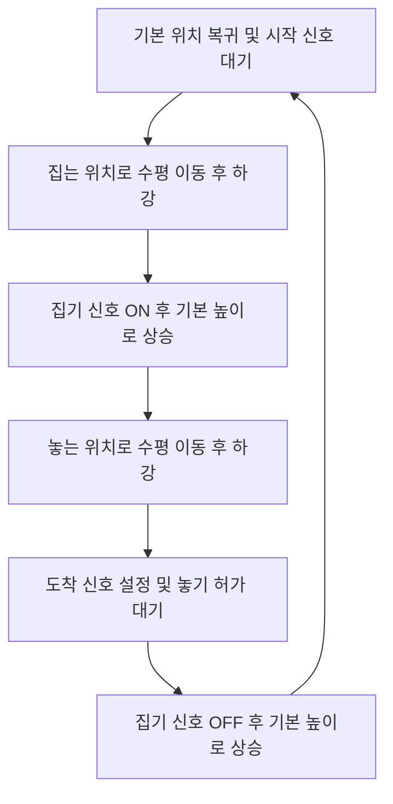

# LineWatch

제공 모델과 자체 C# 제어로 만드는 로봇 피킹·분류 라인 관제 시뮬레이터 포트폴리오입니다.

## 현재 진행 상태

LW-01~03의 작업 기반을 자체 구동 코드로 전환했습니다. RobotLab의 Starter Drive·Sensor·Grip·PLC 신호·자동 피킹 로직·시뮬레이션 컨트롤러를 제거하고, 단일 축 이동·중간 정지·복귀와 물체 감지를 새 C#으로 다시 검증했습니다. 새 Windows x64/Mono 빌드는 `Builds/Windows-OwnCode/LineWatch.exe`이며 빌드 오류는 0건입니다. 새 exe의 실행·종료 확인은 실행 권한 요청이 거절되어 미완료입니다. 기존 LW-02 실행 검증 이력은 보존합니다. 4축 SCARA·FK·IK·분류·관제·서버는 아직 구현하지 않았으며 LW-04는 미착수입니다.

자세한 범위와 검증 기준은 [기획안](Assets/Docs/Starter_Portfolio_Plan.md)에 있습니다.
실제 작업 순서와 완료 기준은 [작업 체크리스트](Assets/Docs/LineWatch_Work_Plan.md)를 따릅니다.

## 새 대화에서 이어가기

상세한 현재 상태·중요 파일·미해결 사항·미커밋 변경은 [워크플랜의 새 대화 인수인계](Assets/Docs/LineWatch_Work_Plan.md#새-대화-인수인계)에, 단계별 사용자 작업·AI 작업·검증 근거는 [기여와 검증 누적 이력](Assets/Docs/LineWatch_Work_Plan.md#기여와-검증-누적-이력)에 기록합니다. 새 대화에서는 이 두 절과 아래 AI 역할 분담을 먼저 읽고, 요청받은 LW 범위에서 이어갑니다.

최종 포트폴리오 정리에는 이 누적 이력과 단계별 완료 기록을 사용합니다. AI가 작성·실행한 부분과 사용자가 직접 확인한 부분을 구분하며, 이후 사용자의 수동 재현·코드 리뷰가 확인되면 날짜와 근거를 추가합니다. 중요한 기록과 측정값은 Markdown에 남기고, Git에서 제외된 로컬 로그가 없는 환경에서는 이전 검증 기록과 새 검증을 구분합니다.

## 개발 환경

- Unity 6000.3.21f1 / URP
- realvirtual Starter 6.3.6 (별도 설치)
- Windows PC 우선

## 프로젝트 열기

1. 이 저장소를 클론하고 Unity Hub에 프로젝트 폴더를 추가합니다.
2. [realvirtual Digital Twin Starter 6.3](https://assetstore.unity.com/packages/tools/utilities/realvirtual-digital-twin-starter-6-3-366612)을 본인 Unity 계정의 My Assets에 추가합니다.
3. Unity Package Manager의 My Assets에서 Starter를 다운로드·가져오기 합니다. 검증한 버전은 6.3.6입니다.
4. Active Input Handling을 Both로 설정하고 Unity를 재시작합니다. URP와 TextMesh Pro 필수 리소스를 확인합니다.
5. `Assets/01.Scenes/RobotLab.unity`를 열고 Play로 실행합니다. 작업 씬은 Starter 구동 코드를 사용하지 않으며 모델·재질 참조를 위해 에셋 설치가 필요합니다. Getting Started 샘플은 학습용입니다.

세부 설치 절차는 [제작사 가이드](https://realvirtual.io/doc/unity/basics/installation/)를 참고합니다. Starter 원본과 샘플은 공개 저장소에 포함하지 않아 각 개발 환경에서 직접 설치해야 합니다.

## 에셋 활용과 본인 구현 범위

2026-11-13부터 **에셋은 모델·재질·텍스처·UI 등 표현에 활용하고, 구동·감지·이송·생성·집기·운전 진행은 프로젝트 코드로 구현**합니다. UI 등 직접 제작하기 어려운 표현 요소는 에셋을 사용할 수 있으며 사용 범위를 기록합니다. 패키지 원본은 수정하지 않습니다.

현재 코드는 `RotaryAxis`(회전축), `PresenceSensor`(Trigger 감지), `MachineControlLab`(시험 명령)과 반복 검증 도구입니다. `ScaraRobot_Work`는 원본 프리팹 상속을 풀고 시각 모델 계층을 유지한 작업 프리팹입니다. 씬 재열기에서 원본 Starter 스크립트·프리팹 의존성 0개와 시각 자산 참조 유지를 확인했습니다. 코드와 씬 구성에는 Codex의 구현 지원을 받았으며 기능별 역할은 아래에 구분합니다.

New Gen Urban은 이 포트폴리오에 사용하지 않습니다.

## 포트폴리오에 활용할 주요 사례

현재는 작업 기반과 단일 축·센서 연결을 검증한 단계입니다. 아래는 실제 코드·설정·측정 근거가 있는 사례이며, 구현과 자동 검증에는 AI 지원을 활용했습니다. 작업별 사용자·AI 역할은 다음 절에 기록합니다. 이후 LW에서 의미 있는 설계 판단이나 문제 해결이 확인되면 이 내용을 갱신합니다.

### 제공 자동 동작과 프로젝트 제어의 충돌 방지

- **확인한 제약:** 제공 `LogicMove3AxisPickAndPlace`는 시작 신호가 없어도 `Start()`에서 세 Drive에 기본 위치 이동을 명령합니다. 자체 코드와 함께 활성화하면 같은 관절에 서로 다른 목표를 보낼 수 있습니다.
- **선택과 이유:** 초기에는 Variant에서 제공 로직만 비활성화했습니다. 현재는 시각 모델을 유지하면서 Starter 동작 컴포넌트를 제거하고 자체 축 코드만 제어하도록 변경했습니다.
- **확인 근거:** 씬 재열기에서 원본 구동 코드·프리팹 의존성 0개를 확인했습니다. 자체 구현의 세 Play 세션·총 9회에서 이동·중간 정지·복귀와 센서 진입·이탈을 통과했습니다. 이전 Starter 연결 시험과 이번 자체 구현 검증은 별도 이력으로 보관합니다.

### 관절 목표값과 공간 좌표의 구분

- **확인한 제약:** 제공 로직의 `Position1/2`는 `Vector3`이며 주석에는 mm 좌표로 설명되어 있지만, SCARA 프리팹의 Axis1·2는 회전축이고 Axis3는 직선축입니다. 타입과 변수명만으로 월드 XYZ 좌표라고 해석하면 축의 의미와 단위를 잘못 연결할 수 있습니다.
- **선택과 이유:** 설치된 Drive 구현과 프리팹의 Direction 설정을 함께 확인했습니다. 세 값은 각각 회전각·회전각·직선 이동량으로 구분하고, 목표 TCP 위치에서 관절값을 계산하는 IK는 별도 구현 범위로 정했습니다.
- **확인 근거:** 현재 자체 축은 모델 홈 자세 기준 로컬 Y축을 회전시킵니다. 단위는 도(°), 속도는 30°/s, 시험 제한은 ±170°이며 +30°와 -15°에서 실제 Transform을 확인했습니다. 전체 4축 좌표계·제한·홈·TCP 확정은 LW-04 범위입니다.

### 상태값과 실제 3D 동작의 교차 검증

- **검증 과제:** API 호출 성공이나 `IsAtTarget`만으로는 실제 모델 이동, 정지 유지, 센서에 연결된 물체까지 모두 확인할 수 없습니다.
- **선택과 이유:** 반복 검증 도구에서 Drive 목표값과 실제 관절 회전을 비교하고, 이동 도중 정지 후 여러 물리 스텝 동안 변화를 측정했습니다. 센서는 시험 물체를 실제 Trigger 안팎으로 이동시키고 점유 상태·감지 대상·전이 횟수를 함께 확인했습니다.
- **측정 결과:** 자체 구현 9회 모두 목표·홈 회전 오차와 정지 후 변화가 보고서상 0°였습니다. 센서 진입·이탈은 각각 9회이며 점유 중 중복 전이가 없었습니다. 복수 Collider 및 센서·물체 비활성화 복구도 통과했고 최종 보완 후 Collider 제거 사례도 확인했습니다. 단일 가상 축의 Editor 검증이며 전체 정적 검사 제한과 FK·IK 미구현은 별도로 기록합니다.

## AI 협업과 역할 분담

개발 도구로 Codex와 Unity CLI를 사용합니다. 아래 구분은 2026-11-13까지 대화와 실행 결과로 확인한 내용의 요약이며, 날짜별 상세 근거와 이후 변경은 워크플랜의 누적 이력에 남깁니다. 직접 작성한 코드의 비율이나 AI 사용에 따른 시간 절감률은 측정하지 않았습니다.

| 작업 | 사용자가 수행·결정한 일 | AI가 수행한 일 |
|---|---|---|
| 방향과 범위 | 물류 관제·4축 SCARA FK·IK라는 목표와 단계별 진행 범위 제시, Urban 제외 및 커밋 여부 결정 | 작업 순서·완료 기준 정리, 구현 선택지와 검증 결과 설명 |
| 초기 환경 | Starter 설치·Both 입력·제공 데모 동작 확인 완료를 전달, RobotLab 초기 씬 생성·저장 | 프로젝트 버전·패키지·입력 설정·씬 상태 및 CLI 연결 재확인 |
| LW-01 | 씬 준비 후 다음 배치 작업을 요청 | 바닥·SCARA Variant·필수 컨트롤러 배치, 자동 피킹 비활성화, 재열기·참조·Play 검증 |
| LW-02 | 실제 실행물의 Alt+F4 정상 종료를 직접 확인 | 빌드 씬 정리, Windows 빌드, 실행 화면·프로세스·로그 확인 및 결과 기록 |
| 제공 코드 분석 | `LogicMove3AxisPickAndPlace` 설명과 포트폴리오 문서화를 요청 | 설치된 원본 코드 분석, 관절 단위·상태 전이·신호·한계 설명과 README 작성 |
| LW-03 | Drive·Sensor 연결 구현 및 기여 구분 기록을 요청 | 연결 코드·시험 프리팹·반복 검증 도구 작성, 실제 Unity 실행·측정, 문서화 |
| LW-01~03 자체 코드 전환 | 에셋은 모델·UI 등에 활용하고 구동·진행은 새 코드로 구현하도록 방향 변경 | Starter 동작 컴포넌트 제거, 자체 축·센서·시험 코드 재구현, 씬·프리팹 연결과 반복 검증, Windows 빌드 및 문서 갱신 |
| 에디터 조작 패널 | 조작 위치 개선을 요청하고 새 패널이 잘 작동한다고 직접 확인 | UI Toolkit Inspector 버튼·실시간 상태·별도 조작 창 메뉴 작성, 컴파일 및 표시 확인 |

현재 코드는 Unity 6000.3.21f1에서 컴파일·씬 재열기·관절 Transform·실제 물리 접촉·콘솔로 확인했습니다. 초기 Starter 연결과 이번 자체 코드 작성·자동 검증은 AI가 수행했습니다. 사용자는 2026-11-13에 Editor 조작과 새 패널이 잘 작동함을 직접 확인했습니다. 사용자 독립 코드 리뷰 완료는 아직 미확인입니다.

### 포트폴리오 설명 예시

> 제공 모델을 활용하고 구동은 프로젝트 C#으로 구현하는 물류 관제 시뮬레이터를 개발하고 있습니다. 프로젝트 목표와 단계별 범위를 정하고 초기 환경·제공 데모, 초기 Windows 실행물의 정상 종료를 직접 확인했습니다. 이후 모델과 동작 코드를 분리하는 방향을 정했고, 자체 축·센서 코드와 자동 검증·문서 작성에는 Codex를 활용했습니다. 에셋, AI 지원 코드, 앞으로 구현할 기능을 구분해 관리하고 있습니다.

### 직접 설명·재현해 둘 항목

- `MoveTo()`의 목표 명령, `IsAtTarget`의 도착 판정, `Stop()`의 중간 정지를 구분하기.
- 회전각과 공간 좌표를 구분하고 축 수치와 실제 Transform을 따로 비교하는 이유 설명하기.
- 물체를 센서 안팎으로 옮겨 `Occupied`·`DetectedObject`·진입·이탈 횟수를 확인하기.
- Starter 동작 컴포넌트를 제거한 이유와 단일 축 시험·FK·IK 미구현 범위를 설명하기.

## LW-03: 자체 축·센서 구현

[RotaryAxis](Assets/02.Scripts/LineWatch/RotaryAxis.cs)는 `FixedUpdate()`에서 속도에 맞춰 로컬 회전을 적용합니다. `MoveTo()`는 유한값·시험 제한을 검사하며 `Stop()`은 현재 자세와 미완료 목표를 유지하고 이동을 멈춥니다. 가속·동역학·충돌 기반 로봇 구동은 구현하지 않은 운동학적 모델 시험입니다.

[PresenceSensor](Assets/02.Scripts/LineWatch/PresenceSensor.cs)는 BoxCollider Trigger 접촉을 집합으로 추적합니다. 복수 Collider에서도 점유 전이를 한 번만 집계하고 접촉 Collider가 비활성화·제거되면 점유를 정리합니다. 시험 물체는 중력을 끈 Kinematic Rigidbody이며 실제 물리 접촉으로 확인합니다. 상품 MU·PLC·자동 피킹은 이 단계 범위가 아닙니다.

[MachineControlLab](Assets/02.Scripts/LineWatch/MachineControlLab.cs)과 동명 프리팹에 명령·SensorVolume·Probe·SensorBase를 묶었습니다. 별도 SCARA Axis1 참조는 씬 오버라이드에 저장하며 Play 진입만으로 자동 운전을 시작하지 않습니다.

### 수동 재현

1. `Assets/01.Scenes/RobotLab.unity`를 열고 Play를 시작합니다.
2. 상단 `LineWatch → 조작 테스트`로 별도 조작 창을 엽니다. Hierarchy의 `MachineControlLab`을 선택해 Inspector 상단 버튼을 사용해도 됩니다.
3. `축 30° 이동`으로 Axis1을 회전시킵니다. `축 0° 복귀` 후 이동 중 `축 정지`를 누르고, 다시 복귀 명령을 내려 이동을 확인합니다. 시험 각도를 바꾸면 이동 버튼에 해당 값이 표시됩니다.
4. `시험 물체 → 센서 안`·`시험 물체 → 센서 밖`을 누릅니다. 패널에서 현재·목표 각도와 이동 상태, 센서 점유·진입·이탈 횟수를 확인합니다. Play 전과 일시정지 중에는 조작 버튼이 비활성화되고 안내가 표시됩니다.
5. Play를 종료하고 재실행해 반복합니다. 이 시점에는 로봇 전체의 피킹 시퀀스나 관제 UI가 없습니다.

조작 패널은 [MachineControlLabEditor](Assets/02.Scripts/LineWatch/Editor/MachineControlLabEditor.cs)의 에디터 도구입니다. Windows 실행물에는 포함되지 않습니다. 사용자가 새 패널의 정상 동작을 직접 확인했습니다.

### 자동 검증과 측정 결과

[반복 검증 도구](Tools/Verification/VerifyMachineControl.cs)는 실제 관절 회전과 물리 센서를 검사하고 JSON을 `Logs/LW03-OwnCode`에 저장합니다. RobotLab이 Play 중이고 백그라운드에서도 프레임이 진행되는 상태에서 실행합니다.

```powershell
unity command script run --file Tools/Verification/VerifyMachineControl.cs --entry VerifyMachineControl.Run --project-path "D:\Unity_study\LineWatch" --caller plugin --skill unity-pipeline --timeout 35 --format json
```

2026-11-13 자체 코드 전환 후 씬 재열기를 포함한 세 Play 세션에서 각 3회, 총 9회 검증했습니다. 마지막 세션은 제거된 Collider 정리 보완 후 실행했으며 실제 Collider 제거도 시험했습니다. 이전 Starter 연결 시험 기록은 워크플랜에 보존합니다.

| 검사 | 실제 결과 |
|---|---|
| 0→30° 이동 및 도착 | 9회 통과, 자체 축 목표값 오차 0° |
| 실제 관절 Transform의 회전량 비교 | 보고서상 오차 0° |
| 복귀 도중 약 26~27°에서 정지 | 9회 통과, 정지 후 축·Transform 변화 0° |
| 정지 후 0° 복귀 | 9회 통과, 실제 홈 회전 오차 0° |
| 시험 물체 진입·이탈 | 기본 시험 진입 9회·이탈 9회, 점유 유지 중 중복 전이 없음 |
| 재열기·재실행 | Axis1·Sensor·Probe 참조 유지, Play 콘솔 오류 0건 |
| 추가 검사 | 음수 회전, 잘못된 목표 거부, 복수 Collider·비활성화 복구 및 Collider 제거 통과 |

측정 대상은 단일 가상 회전축이며 4축 FK·IK는 후속 단계입니다. 전체 메타·스크립트 참조 검사에서도 기존 Volume·Starter 자산 오류 20건·경고 9건이 남아 있습니다. 자체 코드·작업 프리팹·RobotLab 관련 정적 오류는 0건입니다. 전체 정적 검사는 미통과이며 새 보고서·반복 측정 JSON·화면은 Git 제외 경로 `Logs/LW03-OwnCode`에 보관합니다. Windows 빌드는 오류 0건·기존 HDRP 참조 경고 2건으로 성공했으며 새 exe 실행 검증은 미완료입니다.

## 이전 Starter SCARA 피킹 로직 분석 (현재 실행에 사용하지 않음)

realvirtual Starter 6.3.6의 제공 스크립트 `LogicMove3AxisPickAndPlace`를 분석해 Drive 제어, 도착 판정, 집기 신호와 동작 순서의 연결 방식을 확인했습니다. 아래 내용은 **제공 코드의 분석 결과**이며, 해당 로직을 직접 구현한 성과로 표시하지 않습니다. 분석 대상의 로컬 설치 경로는 `Packages/io.realvirtual.starter/Runtime/PLCLogics/LogicMove3AxisPickAndPlace.cs`입니다.

### 역할과 제어 방식

이 스크립트는 세 개의 Drive에 미리 설정한 관절 목표값을 보내고, 도착 여부에 따라 다음 동작으로 넘어가는 상태 머신입니다. `Start()`에서 세 축을 기본 위치로 이동시키고, `FixedUpdate()`에서 문자열 `status`와 각 축의 `IsAtTarget`을 확인해 순서를 진행합니다.

`DriveTo()`는 목표값을 설정하고 이동을 시작하는 호출입니다. 이동 완료까지 호출을 대기시키지 않으며, 실제 이동은 Starter의 Drive가 담당합니다. 두 회전축에 명령을 함께 보내고 두 축 모두 도착했는지 확인하지만, 이 스크립트에서 두 축의 도착 시간을 일치시키는 계산은 수행하지 않습니다.

### 관절 목표값과 좌표의 구분

`StandardPos`, `Position1`, `Position2`는 `Vector3` 타입이지만, 현재 SCARA 프리팹에서는 **월드 XYZ 좌표가 아닌 세 Drive의 목표값 묶음**입니다. `.x`는 Axis1, `.y`는 Axis2, `.z`는 Axis3에 전달됩니다. Axis1·2는 로컬 Y축 회전으로 단위는 도(°), Axis3는 로컬 Y축 직선 이동으로 단위는 mm이며 이동 부호는 Drive 설정을 따릅니다.

| 원본 프리팹 설정 | Axis1 (°) | Axis2 (°) | Axis3 (mm) |
|---|---:|---:|---:|
| `StandardPos` — 기본 위치 | 90 | 0 | 0 |
| `Position1` — 집는 위치 | 0 | 0 | 100 |
| `Position2` — 놓는 위치 | 90 | 90 | 100 |

예를 들어 `Position2 = (90, 90, 100)`은 두 회전축에 각각 90°, 수직축에 100mm를 명령한다는 의미입니다. 관절값으로 TCP 자세를 계산하는 FK나 목표 TCP 자세에서 관절값을 구하는 IK는 이 스크립트에 포함되어 있지 않습니다.

### 동작 순서와 신호



| 신호 | 제공 코드에서의 동작 |
|---|---|
| `StartPickAndPlace` | 기본 위치에서 대기 중일 때 true이면 집는 위치로 이동을 시작합니다. |
| `Pick` | 집는 높이에 도착하면 true, 놓기 허가를 받으면 false로 설정합니다. 현재 프리팹의 Grip은 OneBitControl 방식으로 이 신호를 읽어 집기·놓기를 수행합니다. |
| `PlacePositionReached` | 놓는 높이에 도착하면 true, 놓은 뒤 상승을 완료하고 수평 복귀를 시작할 때 false로 설정합니다. 연결하지 않아도 되는 신호입니다. |
| `ContinueAfterPlace` | 연결되어 있으면 true가 될 때까지 놓기를 보류합니다. 연결되어 있지 않으면 바로 놓고 상승합니다. |

이 로직은 신호 컴포넌트의 `.Value`를 읽고 쓰며, 자체적인 외부 PLC 통신 코드는 포함하지 않습니다. 또한 센서를 직접 읽어 집기 성공을 판정하지 않고 Grip에 집기·놓기 신호를 전달합니다.

### 분석에서 확인한 한계

- **시작 조건:** `Start()`의 기본 위치 이동은 시작 신호와 관계없이 실행됩니다. 대기 상태의 시작 조건도 상승 에지가 아닌 현재 true 여부입니다. `startbefore`는 저장만 하고 비교에 사용하지 않아, 시작 신호가 계속 true이면 복귀 후 다음 사이클이 다시 시작됩니다.
- **성공 판정:** `Pick`을 true로 설정한 직후 상승을 명령하며, 실제 물체를 잡았는지 확인하는 단계는 없습니다. 놓기 성공과 상품 처리 완료도 별도로 검증하지 않습니다.
- **실패 대응:** 이동 시간 초과, 명령 수준의 도달 가능성 검사, 고장 복구·일시정지 상태를 이 스크립트에서 관리하지 않습니다. 도착 조건이나 놓기 허가가 충족되지 않으면 해당 상태에 머뭅니다.
- **참조 검사:** `StartPickAndPlace`를 일부 구간에서는 null 검사하지만, `FixedUpdate()` 마지막에는 `.Value`를 무조건 읽습니다. Drive와 Pick도 필수 연결을 전제로 하므로 참조가 빠지면 예외가 발생할 수 있습니다.

### LineWatch에 적용한 경계와 후속 구현

초기 LW-01~03에서는 SCARA Variant에 Drive·Grip·Sensor를 유지하고 제공 피킹 로직만 비활성화했습니다. 이후 사용자 요청으로 모델 계층을 재사용하는 독립 작업 프리팹으로 전환하고 제공 동작 컴포넌트와 씬 컨트롤러를 제거했습니다. 이 절은 학습 이력이며 현재 실행 구조의 설명이 아닙니다. 패키지 원본은 수정하지 않았습니다.

초기 Drive·Sensor 연결과 이후 자체 축·센서 재구현은 AI 지원으로 구현·검증했습니다. 다음 범위는 4축 SCARA 구성과 자체 FK·IK이며 이후 이송·집기·진행 제어도 프로젝트 코드로 구현합니다. 기능별 완료 여부와 역할 분담은 작업 체크리스트 및 위 AI 협업 기록에서 구분합니다.

## 저장소에서 제외하는 항목

- Unity 캐시·로그·빌드 결과와 자동 생성 IDE 솔루션
- 유료 에셋 보관 폴더 Assets/10.Assets 및 해당 폴더 메타데이터
- realvirtual Starter 원본 패키지와 가져온 Starter 샘플

로컬에 설치한 에셋은 삭제하지 않습니다. 제3자 에셋의 이용 조건은 각 제작사 라이선스를 따릅니다.
